# Changelog

This log records **implemented source, asset and documentation work** for [SORA: After the Rain](https://github.com/haizzdungnay/SORA-After-the-Rain), with links to real GitHub PRs and visual evidence where available.

> **Release and evidence policy:** `VS01`, `V02`, `V03`, `V04` and `V05` are **internal environment-art iteration names**, not published playable releases or new SemVer tags. A 3D GLB, a Unity Editor staging helper and a passing static CI job do **not** by themselves prove Unity Play Mode, collision, performance or Windows build acceptance. Original/modified AFX assets are kept outside this public repository under the creator's distribution conditions. All newly authored diagrams below are explicitly **schematics, not in-game screenshots**.

## [Unreleased] — development history through 2026-11-09

### 2026-11-09 — complete environment source archives and character-folder sync

- Store all **7 environment ZIPs plus the original AFX GLB** from `3d model enviroment/` in Git LFS at the owner's explicit request: **321,718,846 bytes**. Retain complete archives, license notices and the duplicate loose GLB as supplied.
- Inspect all seven ZIPs: CRC and entry-path checks passed. Record file sizes, SHA-256, contents and source terms in the folder's `SOURCE_MANIFEST.json` and [Vietnamese intake guide](3d%20model%20enviroment/README.md); update `Docs/ASSET_REGISTER.csv`.
- Identify **149 meshes / 34 materials / 107 embedded images** in the AFX street; its loose GLB matches the ZIP payload. The five Kenney packs contain **321 model variants** in FBX/GLB/OBJ and include CC0 notices. Asphalt 4K matches the previously registered source hash.
- Follow the owner's folder move from `3d model/` to `3d model charater/`; all **6 character ZIPs** retain their original SHA-256. Update LFS patterns and current character documentation paths.
- These are source backups and inspection results. The original AFX street is not the assembled private SORA V03 layer; the authored V05/V06 map still needs Unity integration. Current playable-demo validation remains recorded below.

### 2026-11-09 — direct playable-demo launch and blank-scene diagnosis

- Add **SORA > 6. Play Demo / F6**: open `SORA_Prototype.unity` before entering Play Mode, prompt to save modified scenes, and respect cancellation. Ignore scene-open/play requests while already playing or transitioning.
- Reproduce the empty sky in `Untitled`: only a camera/light were loaded, without `SoraDemoCore`. Preserve a local recovery copy before opening the playable scene. Add an EditMode regression for one enabled bootstrap and its enabled build-scene entry.
- Verify **16/16 EditMode tests** using Unity **6000.3.7f1**, offline validation, and real Play Mode startup, movement and Tab switching. Local logs: `Logs/editmode.log`, `TestResults/editmode.xml`, `Logs/playtest-editor.log`; captures: `Artifacts/Playtest/`. The F6 shortcut was exercised in the Editor.
- Verify the V03/V05/V06 public GLB signatures and SHA-256 against their manifests. The complete private V03 base is absent on this workstation; V05/V06 have not been imported or integrated. Current gameplay uses the existing procedural v0.5 district. Full traversal, art/collision acceptance and a Windows build remain pending.

| Actual Unity Play Mode startup | Actual procedural street in the playable demo |
|---|---|
| 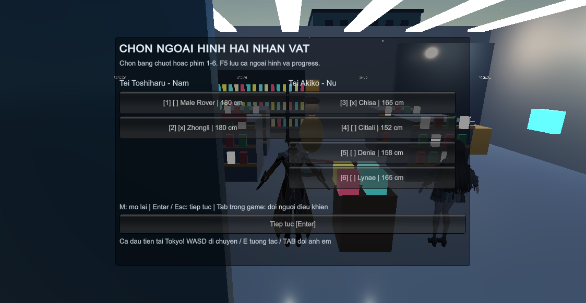 | 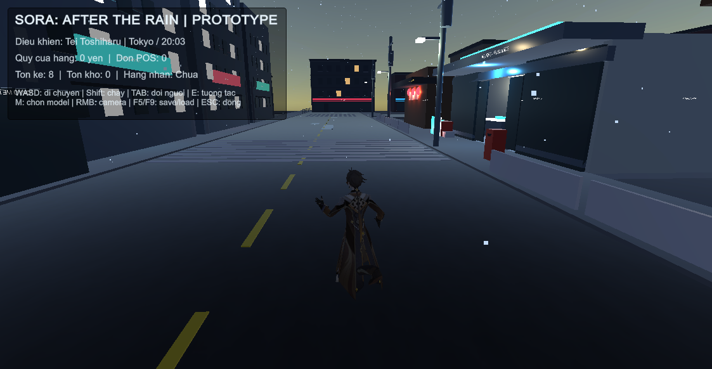 |

*Game View crops of genuine Unity Editor captures; these show the current prototype, not the V05/V06 authored map.*

### 2026-11-09 — V06: additive detail pass for 60 expansion-block storefronts (DRAFT; Unity acceptance pending)

- Build **3,301 3D detail instances** across all **60 existing V04/V05 expansion facades** from their real 9-block layout. Add projected signs, awnings, door frames, shop-display silhouettes, upper-floor framing/balconies, rear windows, side services and roof utilities; deliberately preserve 24 older V03 facades for their own QA pass.
- Preserve the V05 map and **42 Kenney vehicles**; V06 is an **additive, non-colliding GLB overlay**, not a replacement. Use **V03 base + V05 full replacement + V06 details**, all at identity transform. Never stack V04 and V05.
- Exported model: `ArtSource/Generated/V06_CC0/SORA_V06_9Block_Facade_Details.glb`, **567,224 bytes**, SHA-256 `07fd3aaf559863f5259a6a12eed88163accdbcee69ed3d934b29e8d2ea0cb11b`. The generator and GitHub Actions source/regression/GLB-export checks passed. This is an authored geometry improvement, **not** a completed storefront QA or a Unity render.
- Add `SoraV06FacadeStaging.cs` (Editor-only art QA scene), generator, test file, GitHub LFS workflow and [technical report](Docs/StreetExterior/Reports/2026-11-09-V06-FACADE-DETAIL-PASS.md). No changes to `SORA_Prototype.unity`, POS or save system. **Unity URP material QA, camera/collision walkthrough, rain/night finish and Windows build on the new map are not yet accepted.**
- [Draft PR #22](https://github.com/haizzdungnay/SORA-After-the-Rain/pull/22); avoid merging until Unity screenshot/real map QA confirms alignment and materials.

**Repository status checked 2026-11-07:** The V04 nine-block map and the V05 Kenney assets/model **are both present on `main`** ([#13](https://github.com/haizzdungnay/SORA-After-the-Rain/pull/13), [#15](https://github.com/haizzdungnay/SORA-After-the-Rain/pull/15)); the detailed V05 implementation PR [#16](https://github.com/haizzdungnay/SORA-After-the-Rain/pull/16) has also been merged into its V04 integration branch. **Unity integration with the playable prototype remains unverified.**

### 2026-11-09 — six-model assets, source archives and Unity screenshots on GitHub

- Include all six original ZIP packages in `3d model charater/` and the complete Unity library in `Assets/SORA/Characters/LocalImported/`: six FBX models, textures, 69 URP materials, six source prefabs, six playable prefabs, Humanoid Avatars, Rover's skinned meshes and the Idle/Walk/Run controller. Preserve every existing `.meta` and GUID.
- Store ZIP/FBX/texture binaries in **Git LFS**. A clone with `git lfs pull` can use the playable prefabs without extracting packages or running Blender. See [the updated setup guide](Docs/CHARACTER_MODEL_LIBRARY.md); assets are on the feature branch until review/merge.
- Let offline validation accept hydrated assets above 50 MiB only when Git stores a valid LFS pointer; retain the large-raw-blob guard. Add a standalone regression check with Git and the Python standard library.
- Publish at the owner's explicit request, superseding the initial local-only delivery below. Keep supplied license notices and credits; **publication does not establish redistribution or commercial rights**, which remain unverified in the [asset register](Docs/ASSET_REGISTER.csv).
- Add the genuine Unity Play Mode captures below. The menu is a Game View capture with its readback Y orientation corrected; the Run images show staged animation poses after the automated movement check. These images do not establish manual traversal, performance or Windows-build acceptance.

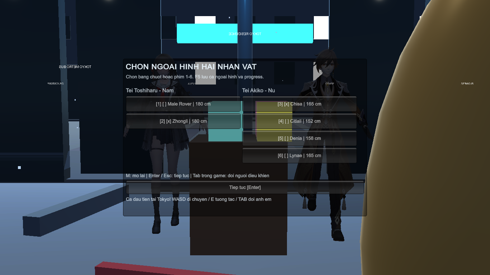

| Chisa (165 cm) and Zhongli (180 cm), Run | Denia (158 cm) and Zhongli (180 cm), Run |
|---|---|
| 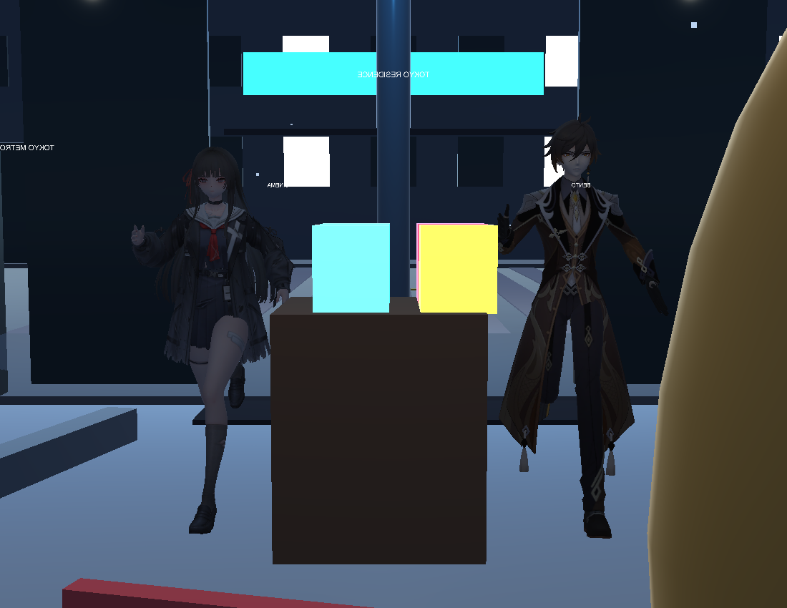 | 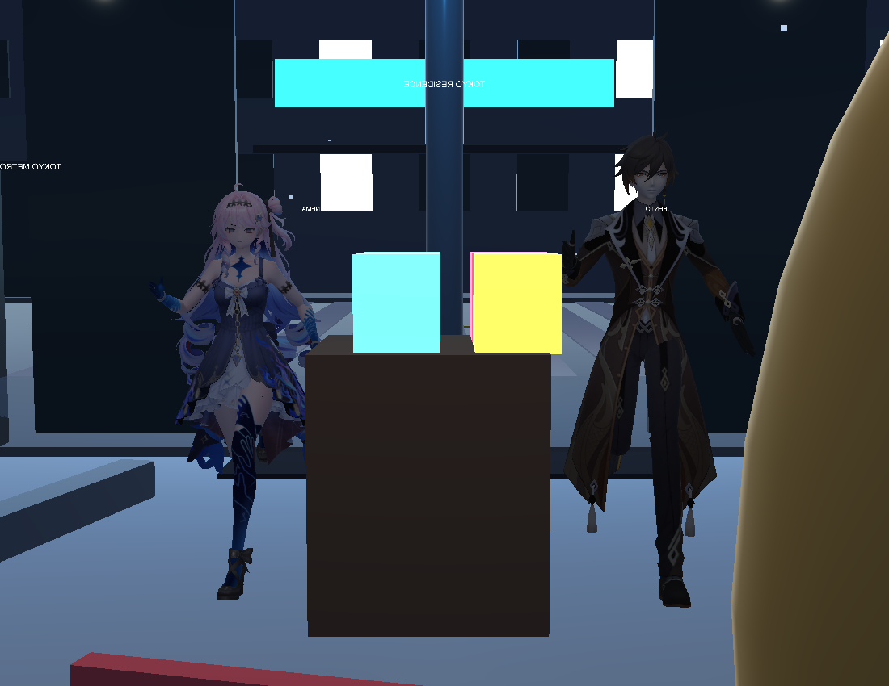 |
| **Citlali (152 cm) and Male Rover (180 cm), Run** | **Lynae (165 cm) and Male Rover (180 cm), Run** |
| 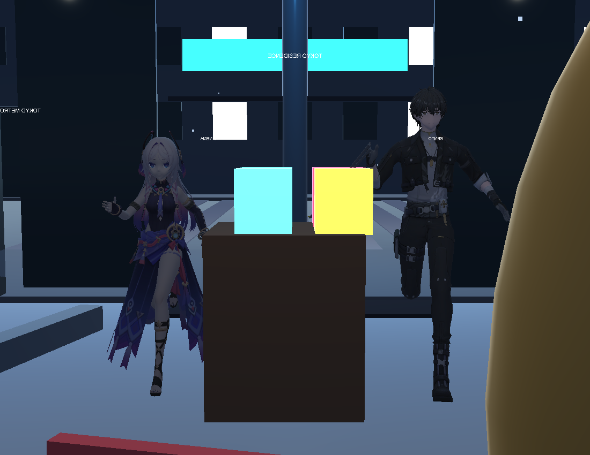 | 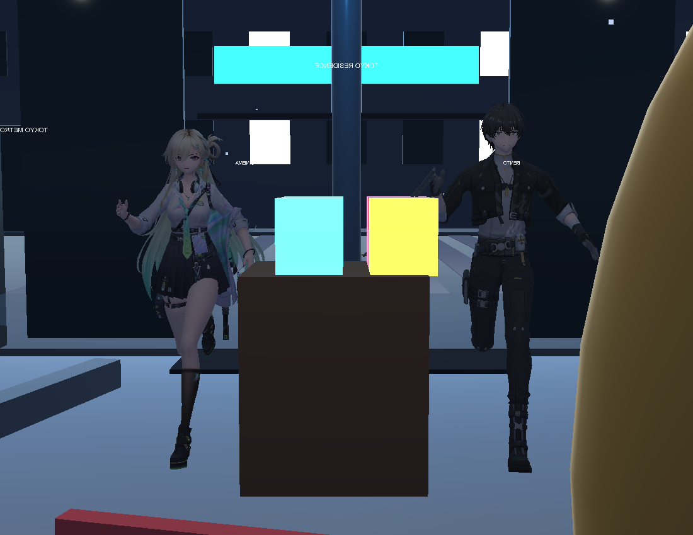 |

*Original captures: `Artifacts/CharacterSelection/playmode-*.png`, Unity 6000.3.7f1 / URP 17.3.0. Models use project-authored locomotion; source toon shaders, cloth/hair physics and exact foot locking remain unfinished. [Verification report and limits](Docs/CHARACTER_SELECTION_REPORT_2026-11-09.md).*

### 2026-11-09 — protagonist model selection and local Humanoid locomotion

- Add a startup model chooser, reopened with **M**: Toshiharu chooses Male Rover/Zhongli; Akiko chooses Chisa/Citlali/Denia/Lynae. Keyboard **1–6** selects, **Enter/Esc** continues, **Tab** still changes control between the two protagonists.
- Set **Chisa/Lynae to 1.65 m, Denia to 1.58 m, Citlali to 1.52 m, and both male models to 1.80 m**. Fit CharacterController and camera height to the chosen appearance while preserving the same gameplay objects and shared progress.
- Persist independent model IDs in the existing schema-1 save with **F5/F9**. Older saves keep their progress; missing local assets fall back to prototype appearances. Reject unknown models and cross-gender slot choices. Opening the menu cancels a draft POS sale without charging and pauses both twins' movement.
- Build six local Humanoid avatars/playable prefabs with the project's authored **Idle/Walk/Run**, driven by actual CharacterController velocity. Map five source rigs, preserve Denia's 187 blendshapes, and add a basic 21-bone region-skinned rig to Rover's static mesh export. No new package or downloaded animation.
- Model, generated rig/mesh/avatar and preview assets initially remained local; the publication update above now includes them. Source binaries and metadata are preserved. Source-game toon rendering, finger rigging for Rover, cloth physics and new interaction animations remain outside this change.
- Verified actual Unity compilation, **15/15 EditMode tests** and an automated **Play Mode** check covering all six choices, AI-driven Speed, stable controller IDs and unchanged shared store state. Inspected genuine local Game View/pose captures and preserved **291/291 pre-existing asset GUIDs**. Windows build and manual gameplay acceptance remain pending; see the report for measured foot-contact limits.

[Updated Vietnamese usage guide](Docs/CHARACTER_MODEL_LIBRARY.md) · [Implementation and verification report](Docs/CHARACTER_SELECTION_REPORT_2026-11-09.md).

### 2026-11-09 — local character model library: six owner-supplied packages

**Status at initial intake:** Imported and checked locally in **Unity 6000.3.7f1 / URP 17.3.0**. The importer, guide and provenance were delivered first; the publication update above now includes the model/texture binaries. Rights review remains pending.

- Prepared **Chisa, Citlali, Denia, Lynae, Male Rover and Zhongli** under `Assets/SORA/Characters/LocalImported/`, with **6 drag-and-drop prefabs and 69 URP materials**. Converted USDZ/glTF sources through Blender; retained original binary FBX and imported Rover's ASCII FBX natively with repaired local texture paths.
- Preserved five source rigs and **Denia's 187 expression blendshapes**. **None of the six packages contains animation clips. Male Rover is a static mesh export without skin/bones**; rigging and locomotion remain separate work.
- Normalized prefab visuals to **1.7 m**, feet at Y = 0 and root Scale = 1; kept colliders and gameplay logic out of the model library. Existing protagonists, prototype scene and store state systems are preserved.
- Verified actual Unity C# compilation/import and the library self-check; **6/6 existing EditMode tests passed**, including Akiko and store-state regressions. Captured a genuine local **Unity Editor preview**, checked **238 stable asset GUIDs** across reimport and passed offline validation. Play Mode and Windows-build acceptance remain pending.
- Recorded source ZIP SHA-256, package contents, credits and limitations. Two packages contain CC BY notices; four have no license document. Underlying commercial-game IP rights remain unverified. Original packages, converted assets and model previews were initially excluded, then included at the owner's explicit request in the publication update above.

[Vietnamese usage guide](Docs/CHARACTER_MODEL_LIBRARY.md) · [Import evidence and limits](Docs/CHARACTER_MODEL_IMPORT_REPORT_2026-11-09.md) · [Asset register](Docs/ASSET_REGISTER.csv).

### 2026-11-06 — V05: Kenney Car Kit replaces parked-vehicle placeholders

**Status:** Source, model and QA metadata **available in `main`** through [PR #15](https://github.com/haizzdungnay/SORA-After-the-Rain/pull/15); detailed review in [PR #16](https://github.com/haizzdungnay/SORA-After-the-Rain/pull/16). This is an art/geometry milestone, **not** a new playable game release.

- Received and validated the owner's **Kenney Car Kit 3.1** source ZIP, including its CC0 license and SHA-256. Stored the original 4.8 MB archive in Git LFS.
- Replaced **42 procedurally made parked cars** with actual Kenney mesh instances, keeping the same parking locations, nine-block geometry, SORA MART and road network. **V05 replaces the entire V04 overlay; do not stack V04 and V05 together.**
- Recovered the external Kenney color-atlas texture and embedded it into exported GLB materials; fixed initial white/untextured vehicle previews.
- Rebuilt vehicle collision proxies using model bounds, preserving **4 continuous perimeter barriers and 16 road-end blocks**. The public replacement GLB is ~20.65 MB (2,198 scene mesh instances); the owner-private assembled variant has additional detail.
- Added a reproducible builder, Git LFS archive and output, [source/QA report](Docs/StreetExterior/Reports/2026-11-06-V05-KENNEY-CAR-KIT-IMPLEMENTATION.md) and an Editor-only staging helper. The [GitHub Actions build](https://github.com/haizzdungnay/SORA-After-the-Rain/actions/runs/42198697484) passed source-hash, GLB-export/reload and structural tests.
- **Pending:** real Unity import, shader inspection, collision and camera traversal with both protagonists, POS/save regressions, nighttime rain and performance.

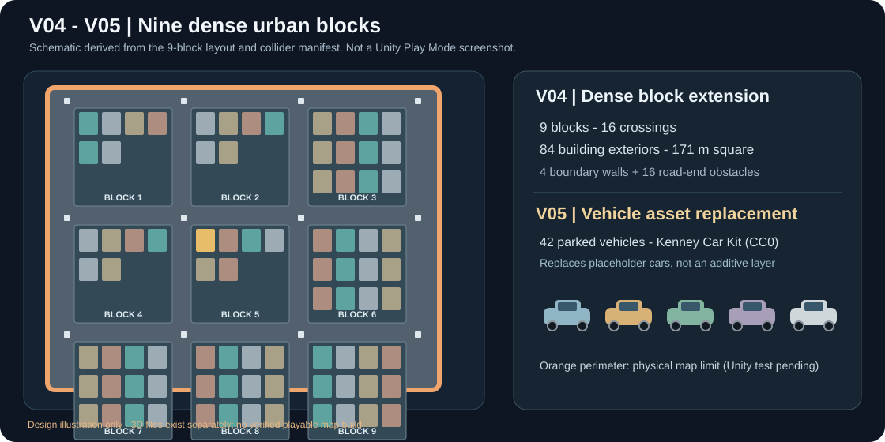

*Illustration of the layout and vehicle change. Not a photograph or Unity capture. Source: [PR #15](https://github.com/haizzdungnay/SORA-After-the-Rain/pull/15), [PR #16](https://github.com/haizzdungnay/SORA-After-the-Rain/pull/16), [V05 manifest](ArtSource/Generated/V05_CC0/manifest.json).*

### 2026-11-06 — V04: compact nine-block neighborhood and world boundaries

**Status:** **Merged into `main`** in [PR #13](https://github.com/haizzdungnay/SORA-After-the-Rain/pull/13).

- Extended the existing V03 four-block layout northward/eastward to **9 city blocks**, **4 roads per axis / 16 intersections** and a nominal **171 × 171 m** playable-footprint design, while preserving the SORA MART placement.
- Added **60 new building exteriors**, bringing the total to **84 building positions**. The five added blocks reached approximately **77.6% nominal ground-coverage** in geometry checks; older rear service areas remain but are screened.
- Created **42 placeholder car models**, extra road marking and asphalt geometry, skyline infill, and background buildings to avoid visible empty horizon beyond the map.
- Added **4 overlapping, continuous outer-wall collision proxies**, **16 road-end barricades**, a ground safety layer and an optional bound-recovery helper for both controlled twins.
- Committed the real **CC0-only V04 overlay GLB** (~20.25 MB; 2,350 mesh nodes), its layout and **122 collider-proxy records** through Git LFS. The complete geometry including AFX-derived V03 remains in a separate owner-private package.
- GitHub's [V04 3D build](https://github.com/haizzdungnay/SORA-After-the-Rain/actions/runs/42193823811) verified GLB export, SHA, layout records and border structure.
- **Not yet accepted:** Unity physics, walking every boundary, door/side/rear façade art quality, URP nighttime lighting, wet reflections or playable Windows performance. Structural wall metadata alone cannot guarantee a character will never fall off the map.

[Detailed V04 build and acceptance report](Docs/StreetExterior/Reports/2026-11-06-V04-NINE-BLOCK-IMPLEMENTATION.md) · [V04 layout JSON](Docs/StreetExterior/V04_DENSE_GRID_LAYOUT.json) · [V04 CC0 GLB](ArtSource/Generated/V04_CC0/SORA_V04_CC0_Dense_Overlay.glb).

### 2026-11-06 — V03: integrated CC0 storefronts, props and PBR asphalt

**Status:** Source and CC0 overlay incorporated in the mainline V04 history; initially reviewed in [PR #12](https://github.com/haizzdungnay/SORA-After-the-Rain/pull/12), reconciled via [PR #13](https://github.com/haizzdungnay/SORA-After-the-Rain/pull/13).

- Expanded the four-block scene from **16 to 24 exterior positions**, with eight additional building shells designed for SORA.
- Placed individually selected **Izakaya Alley / Ramen Shop** and **Japanese School / City Street** components into **23 shop façades**, retaining the custom SORA MART as the remaining major frontage.
- Added bicycles, lanterns, vending machines, plants and sidewalk signage around all 24 parcels, plus small props and vegetation across four internal courtyards.
- Applied **Poly Haven Asphalt 01** diffuse, normal and roughness data to **15 PBR road sections** (wet shader/URP behavior remains pending).
- Corrected the `KHR_mesh_quantization` interpretation of supplied source GLBs so signed 16-bit normalized POSITION values import at sensible scale rather than oversized geometry.
- Built a public **20.78 MB, 1,361-instance CC0-only overlay** in Git LFS, with a reproducible Python generator, checksum manifest and staging-scene tooling. A fuller V03 scene containing AFX-derived geometry was delivered privately.
- **Not yet verified in Unity:** glass/transparent material fidelity, scale with character controllers, colliders, interior visibility, rain and shop-by-shop exterior QA.

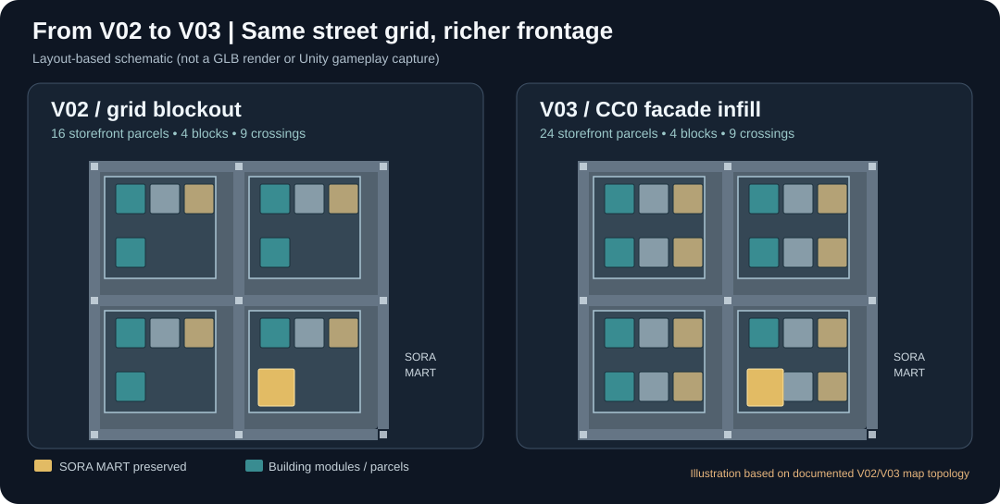

*Documented topology/density diagram, not an in-game capture. Source: [V03 report](Docs/StreetExterior/Reports/2026-11-06-V03-CC0-INTEGRATION.md), [V03 geometry manifest](ArtSource/Generated/V03_CC0/manifest.json).*

### 2026-11-06 — V02: original square-grid neighborhood and CC0 asset library

**Status:** Merged into `main` in [PR #11](https://github.com/haizzdungnay/SORA-After-the-Rain/pull/11).

- Built the first larger **126 × 126 m, 3 × 3-road** neighborhood prototype with **9 intersections, 4 city blocks and 16 candidate shop/building exteriors**. This is a newly planned SORA layout, **not** a copy of the source AFX alley.
- Preserved SORA MART, rearranged/reused AFX parts, and created roads, curbs, crossings, pavement, street furniture and temporary courtyard geometry.
- Received and verified the two 3DAssets.dev CC0 starter scenes and the owner's **Poly Haven Asphalt 01** 4K Blender ZIP; committed the two original GLBs plus **three optimized 2K PBR texture maps** (diffuse/normal/roughness) in Git LFS under `ArtSource/ThirdParty/CC0/`.
- Added content SHA-256 records, asset provenance, import/verification scripts and [a verified intake report](Docs/StreetExterior/Reports/2026-11-06-V02-CC0-ASSET-INTAKE.md). The full original 4K ZIP was not needlessly committed.
- Scene mesh export and offscreen source-model previews were checked; **Unity prefab import and gameplay integration were not checked**.

[See the V02–V03 map illustration above](Docs/Media/Changelog/sora-v02-v03-map-evolution.svg) · [V02 layout](Docs/StreetExterior/V02_GRID_LAYOUT.json) · [CC0 source register](ArtSource/ThirdParty/CC0/README.md).

### 2026-11-06 — VS01: first authored 3D street proof of concept

**Status:** Merged into `main` in [PR #10](https://github.com/haizzdungnay/SORA-After-the-Rain/pull/10).

- Built a **48 m street demonstration with 8 m carriageway**: a newly authored **SORA MART** exterior (nominal 14 m façade, 11 m depth) and two independently re-positioned AFX-source shop groups (**Midori Ramen** and **Hoshi Books**), rather than reproducing the reference alley.
- Added storefront signs, doors/glass, sidewalks, crosswalk, road markings, utility meshes and street props; exported a real textured **271-mesh-instance GLB**, privately delivered for art review.
- Fixed mirrored UV signs detected from real exported GLB previews.
- Added [layout metadata](Docs/StreetExterior/VS01_LAYOUT.json), a Blender extraction utility, geometric checks, Unity staging helper and [VS01 build report](Docs/StreetExterior/Reports/2026-11-06-VS01-IMPLEMENTATION.md).
- The private AFX-derived model is **not distributed in the public repository**. Visual model construction was checked; Unity URP/Play Mode/gameplay acceptance was not.

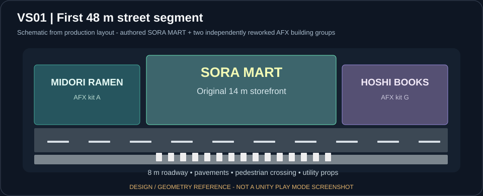

*Original layout schematic, not a Unity screenshot.*

### 2026-11-06 — G0: verified 3D reference, rights and modular-kit design

**Status:** Documentation/tools merged via [PR #9](https://github.com/haizzdungnay/SORA-After-the-Rain/pull/9).

- Inspected the owner-supplied **AFX/CGMotion Japanese street at night** GLB: **149 meshes, 51,687 triangles, 34 materials and 107 embedded textures**. Identified ten **source geometry groups A–J**; these are **not** ten finished SORA storefronts.
- Documented source hashes, actual geometry bounds, candidate groups, gaps in façades/backs, and reusable-asset provenance.
- Recorded the owner's direction: **use AFX components as a kitbash library to create a new SORA city**, not copy AFX's narrow alley or original A–J layout. Updated the phased plan, work packages and multi-session development guide accordingly.
- Added local-only Blender inspection/extraction tools. Kept original and modified AFX source meshes/textures **outside the public repo**, following the source creator's additional conditions.
- **Remaining:** semantic per-module separation/pivots, import/review in Blender and Unity, and exterior quality approval.

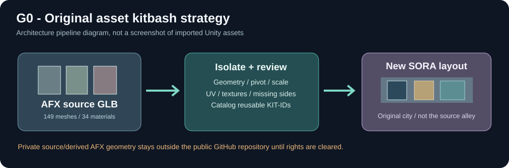

*Source-to-kit design diagram; not a screenshot. [G0 inspection report](Docs/StreetExterior/Reports/2026-11-06-G0-AFX-GLB-INSPECTION.md) · [kitbash design decision](Docs/StreetExterior/AFX_KITBASH_CITY_DESIGN_DECISION_2026-11-06.md).*

### 2026-11-05 — Exterior-art roadmap and individual-store quality gates

**Status:** Documentation merged in [PR #8](https://github.com/haizzdungnay/SORA-After-the-Rain/pull/8).

- Published the phased exterior reconstruction plan, work-package backlog, frontage audit template and session handoff guide.
- Introduced explicit **G0–G8 gates** for source inspection, city layout, staging, representative shopfront quality, SORA MART, all other exteriors, weather/streets, gameplay connection and optimization.
- Established storefront-level QA across front, side, rear and visible roof surfaces, without claiming that planning was equivalent to finished buildings.

[Street rebuild plan](Docs/STREET_EXTERIOR_REBUILD_PLAN.md) · [work packages](Docs/STREET_EXTERIOR_WORK_PACKAGES.csv).

### 2026-11-03 to 2026-11-04 — Tei Akiko 3D model, rig and animations

**Status:** Merged in [PR #6](https://github.com/haizzdungnay/SORA-After-the-Rain/pull/6) and [PR #7](https://github.com/haizzdungnay/SORA-After-the-Rain/pull/7).

- Replaced Tei Akiko's character placeholder with an original **Blender-generated 3D model**, authored textures, materials, Humanoid rig and Unity import pipeline.
- Added **Idle / Walk / Run** animations and a controller for game movement. Model and animation data were checked in with their Unity metadata and importer/source scripts.
- Collected genuine **Unity Play Mode character captures**, which are distinct from the later 3D neighborhood prototype previews. Character model/animation verification should not be interpreted as validation of V03–V05 gameplay integration.

| Akiko — in-game capture | Walk animation | Run animation |
|:---:|:---:|:---:|
| 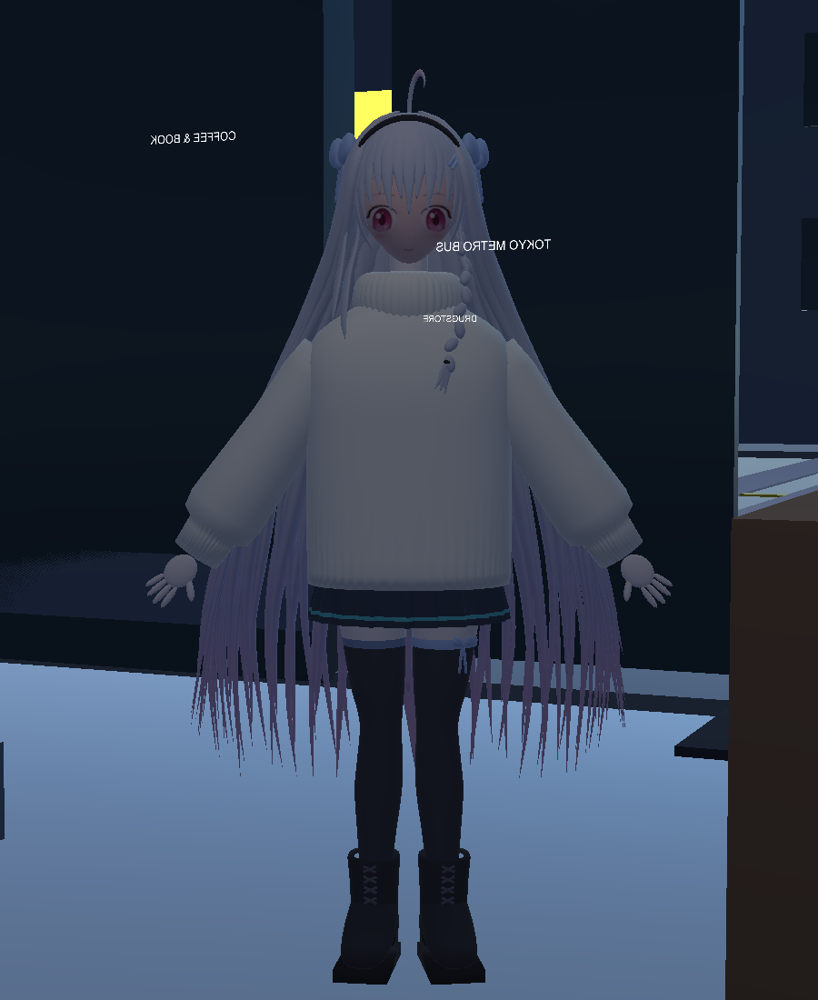 | 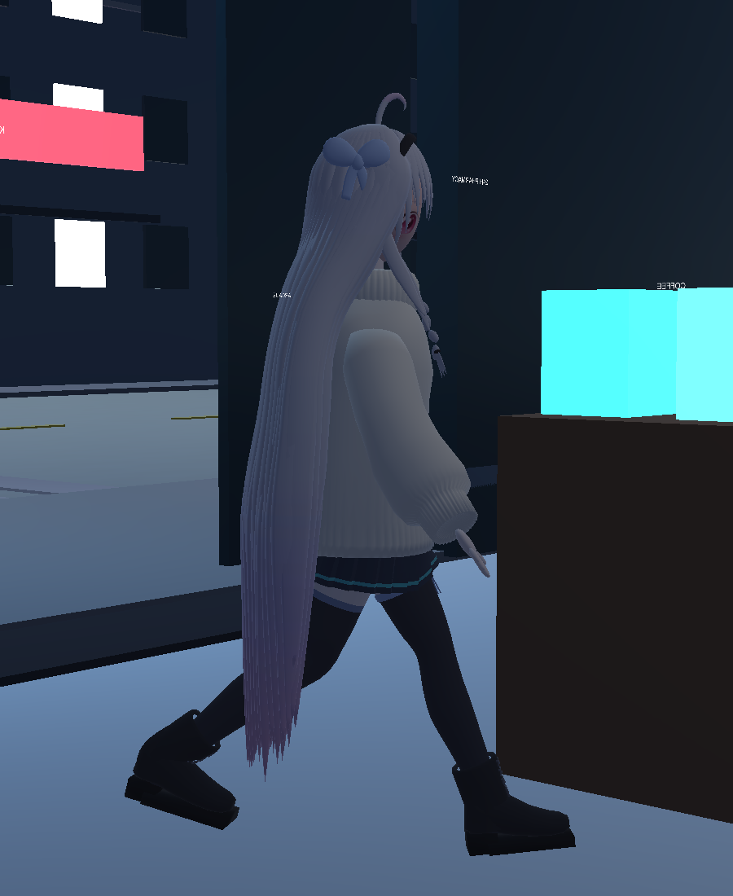 | 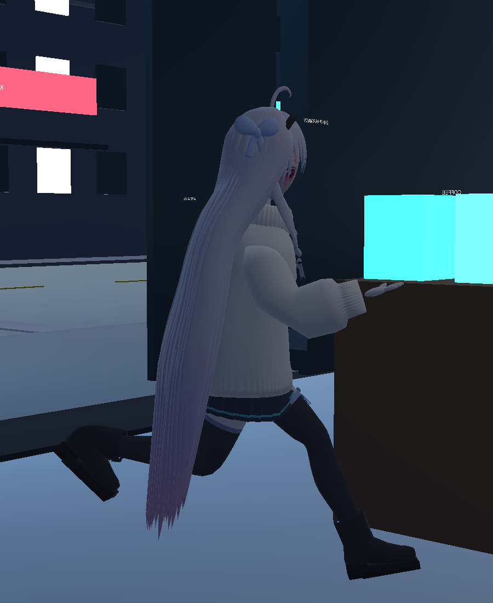 |

### 2026-11-02 — Tokyo neighborhood v0.5 connected prototype

**Status:** Merged in [PR #5](https://github.com/haizzdungnay/SORA-After-the-Rain/pull/5).

- Expanded the original primitive-only world into a connected first-pass Tokyo neighborhood with procedural street-facing buildings and shopfronts.
- Retained the store, two protagonists, camera and gameplay setup as the baseline to protect during later art replacements.
- **Quality note:** This was a functional/procedural blockout, **not** the detailed exterior-art standard now pursued with VS01–V05.

---

## [0.4.0-pre.1] — 2026-11-02

### Source baseline

- Imported the owner-supplied v0.4 prototype and canonical narrative/design baseline.
- Included two switchable placeholder characters, third-person camera, primitive Tokyo/store scene generator, simple store operations, customer relations and JSON quicksave.
- Established stable asset metadata, separate assemblies, legacy input axes/modules and an Editor URP setup path.
- Added five EditMode integrity tests and opt-in licensed Unity test/build scripts.

### Repository presentation

- English, Vietnamese and Japanese READMEs with shared scope and acceptance statements.
- Original project identity banner and social-preview graphic; neither is a gameplay screenshot.
- Architecture overview, contribution guide, issue forms, public roadmap, portfolio copy and release notes.
- Source-integrity CI badge and transparent milestone labelling.

### Validation and limits

- Offline source integrity checks pass; initial import CI passed on `main` and `develop`.
- Unity import/compile, test execution, Play Mode and Windows build remain unverified.
- Source distribution only; no validated executable, production anime artwork or finished narrative is included.

[0.4.0-pre.1]: https://github.com/haizzdungnay/SORA-After-the-Rain/releases/tag/v0.4.0-pre.1
