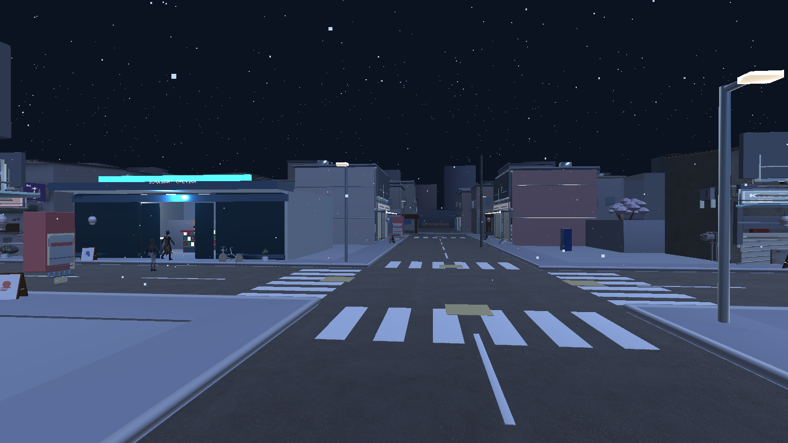
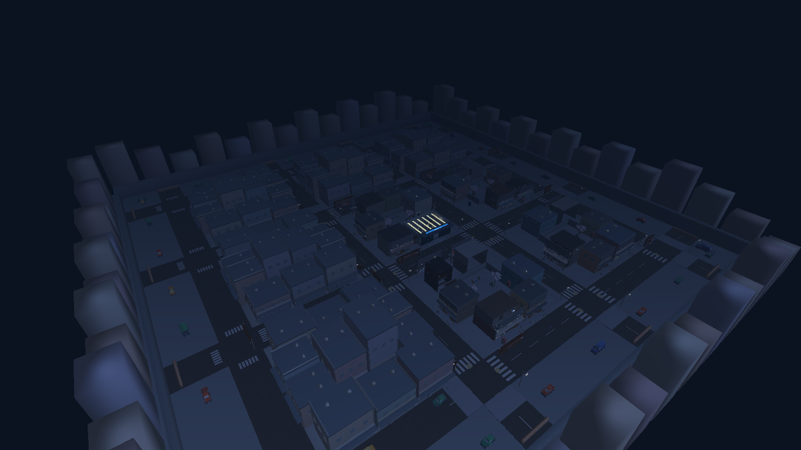

# Review và tích hợp môi trường local — 09/11/2026

## Nguồn và kết luận review

Baseline: `main` tại `52d8c0b` (PR #24/#25 đã merge). Không có PR mở khi bắt đầu; nhánh feature remote cũ không được chép đè lên `main`.

- Hai ZIP chủ dự án bổ sung qua CRC toàn bộ, kiểm tra đường dẫn và SHA-256. Đọc dữ liệu/model; không thực thi script trong archive.
- V05 public có **2.198 mesh instance**, SHA `805fa2e82e5243361db1a7ab8c897462a235e0da7d3f171622eff042ef13f603`. V05 ZIP có **3.241 mesh instance**, SHA `c4800a5f47af6bb4e2740b31ea1417b0644298e3b7fb60b3f6b0e6fb415f3f97`. Cùng 60 tâm lô nhưng nhiều chiều cao nhà, xe và barrier khác nhau; collider hai bản không thay thế cho nhau.
- Manifest V06 chỉ rõ SHA V05 public. V05 ZIP đã có bộ chi tiết riêng; không chồng V06 public lên cặp private.
- glTFast chuyển X từ hệ tọa độ tác giả sang Unity. Loader trước đó giữ collider JSON nguyên X: regression thực tế thấy tâm xe B03-PARK-0 tại **15,5 m**, collider tại **-49,5 m**. Đổi tọa độ collider/layout, offset và bounds để khớp native importer; giữ scale model dương.
- V03 private trước đó không có collider cho 15 cửa hàng gốc. Thêm 15 proxy, chừa SORA MART tương tác; thêm MeshCollider cho đường/vỉa hè đã import. Không thêm collider cho lớp chi tiết V06.
- Guard cũ nhớ điểm đang rơi ở Y=-3 rồi phục hồi về đó khi xuống Y=-10. Regression tái hiện được; bản sửa chỉ ghi nhớ vị trí grounded, giữ nguyên trạng thái enabled của controller và dùng điểm trong cửa hàng nếu chưa có mốc an toàn.

## Cài và chạy

```powershell
git lfs pull
python Tools/StreetExterior/install_private_city.py
python Tools/StreetExterior/install_private_city.py --verify
```

Installer chọn đúng hai GLB và JSON từ ZIP đã kiểm, không giải nén/chạy builder. Từ chối ghi đè bản local khác checksum. V03 NoMart giữ **2.463 mesh instance**, bỏ 129 mesh cửa hàng trùng. Cặp private nằm trong `Assets/Resources/SoraCity/Private/`, cùng collider chuẩn hóa từ ZIP V05. Hai ZIP riêng, thư mục import và metadata riêng được ignore; chỉ code, test, lockfile, ảnh và tài liệu được công khai.

Mở Unity **6000.3.7f1 / URP 17.3.0**, chờ glTFast **6.20.0** import, nhấn **F6**, chọn model rồi **Enter**. Hierarchy có `SORA_CITY_V05_REAL_ASSETS - 9 blocks - 42 Kenney vehicles`; Console ghi `V03 + V05 owner ZIP pair` và `private AFX=True`.

Máy không có ZIP riêng tiếp tục dùng V03 public + V05 public + V06. Không nạp V04 hoặc phố thủ tục cùng map mới. Cửa hàng, hai controller, POS, tồn kho và save schema 1 vẫn do `SoraDemoCore` quản lý. Bầu trời mặc định được bỏ và có một directional light xanh dịu để nhìn rõ map khi test.

## Bằng chứng local

- Unity thực đã resolve/import và compile; lockfile ghi glTFast cùng Burst/Collections mà package yêu cầu, giữ nguyên Unity và URP.
- Regression xe–collider đã FAIL trước sửa (lệch 65 m), PASS sau sửa. Test kiểm đủ 42 xe, tâm X/Z và độ bao phủ collider, cùng 15 lô gốc.
- Kiểm tra Play Mode bằng script trên **cặp ZIP private**: **5.704 MeshRenderer**, **0** material thiếu/không hỗ trợ; hai nhân vật có mặt, không có phố thủ tục trùng.
- **100** lần gọi switch không đổi quỹ/tồn kho; switch hủy draft POS; một sale tăng đúng 380 yen và giảm một hàng; save/load khôi phục quỹ. Save có sẵn trên máy được lưu lại và phục hồi sau test.
- CharacterController của cả hai nhân vật đã thử đi qua **16 road-end barrier + 4 cạnh perimeter**: **40/40** lần bị chặn. Đây là kiểm tra chuyển động bằng script; chưa thay thế walkthrough thủ công từng storefront.
- Log/report local: `Logs/city-playmode.log`, `Artifacts/EnvironmentIntegration/playmode-report.json`, `Logs/editmode.log`, `TestResults/editmode.xml`.
- **20/20 EditMode** PASS trên cặp ZIP private và **20/20** PASS khi tạm đưa private ra ngoài `Assets/` để kiểm tra cấu hình public. Toàn bộ model/metadata riêng đã phục hồi sau test. Báo cáo riêng: `TestResults/city-private-editmode.xml`, `TestResults/city-public-editmode.xml`.
- **Windows x64 build thành công** bằng `Tools/Build-SORA.ps1`; log `Logs/windows-build.log` ghi `Build Finished, Result: Success.` và exit code 0. Bản local: `Builds/Windows/SORA_After_the_Rain.exe` cùng thư mục data; giữ nguyên cả bộ build khi chạy.
- **Standalone startup đã chạy thực:** process player phản hồi; `Logs/city-player.log` xác nhận 5.704 renderer, 122 proxy và `private AFX=True`, không có exception trong lượt startup. Thao tác bàn phím trên EXE chưa được xác nhận; không có screenshot player hợp lệ trong báo cáo này. Ảnh bên dưới là camera Unity Editor trong Play Mode.

Ảnh dưới được render từ camera Unity trong Play Mode, góc máy được đặt để review. Không phải mockup, screenshot thao tác bàn phím hay bằng chứng FPS.





## Giới hạn

Chưa nghiệm thu mỹ thuật hoàn chỉnh: biển hiệu cửa hàng prototype, shader nguồn, kính/emission, bóng, hiệu ứng mưa/che mưa, LOD và FPS trên cấu hình mục tiêu. Save từ phố thủ tục cũ chưa có migration vị trí; cần kiểm tra từng vị trí tải lại trên map mới. Bộ module Kenney chưa dùng tiếp tục là nguồn art; không tự rải tất cả 321 mẫu vào scene. Quyền phát hành game chứa AFX và model nhân vật vẫn cần xử lý riêng; bản local không phải release public.
