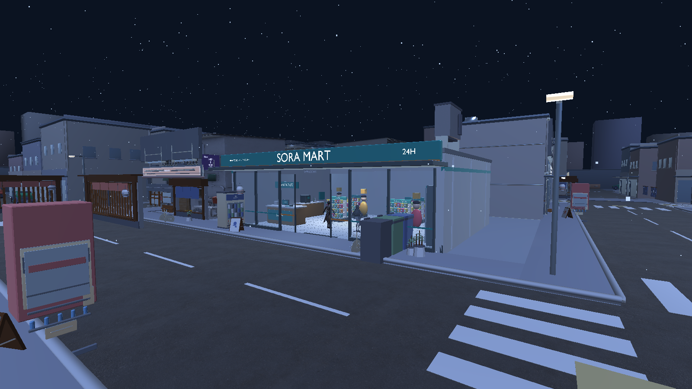
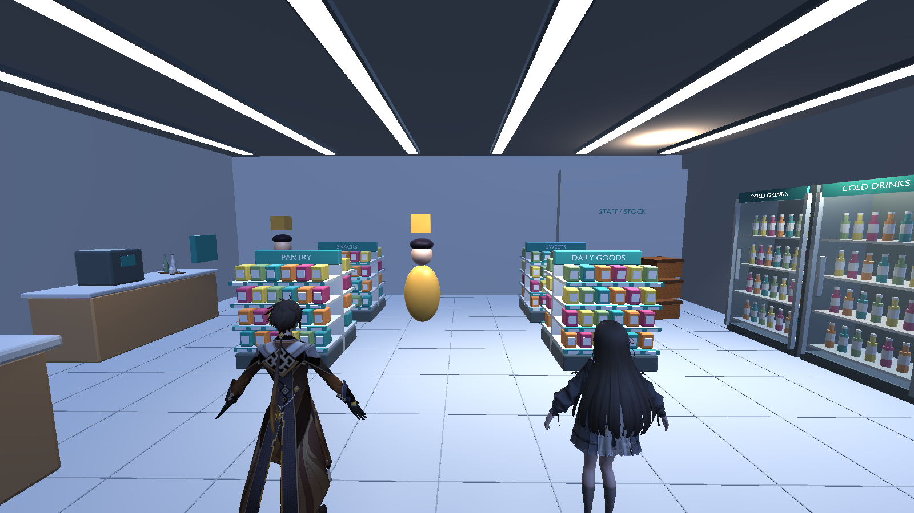

# SORA MART exterior and existing interior - 2026-11-10

## Objective and scope

The owner prioritized the existing store before the rest of the city and selected
both exterior and interior: glass, signage, checkout, shelves, merchandise and lighting.
This changes the work order for EXT-010/011; it does not open more shops or finish G3-G8.

Branch: `feature/sora-mart-finish`, based on `453453a` (`fix/unity-editor-startup`).
That base includes the environment integration and package correction in pending PRs
#26/#27; `main` alone does not contain those corrections yet.

## Changes and architecture

- `Tools/Blender/build_sora_mart.py` builds a dedicated GLB using Blender 5.2, existing
  verified CC0 props, and original SORA architecture, fixtures, package art and mesh lettering.
  It requires no new Python or Unity dependency. Existing WebP palettes become embedded
  PNG images because the installed glTFast importer has no WebP decoder.
- The store has transparent frontage and parked-open glass doors, mullions, jade/orange
  fascia, a complete roof/canopy, side/rear walls, four stocked shelf islands, a checkout,
  four chilled-drink cabinets and a coffee station. Existing CC0 vending, bottle/crate,
  plant, waste-bin and AC assets are reused. No AFX-derived geometry is included.
- `SoraMartVisuals.TryBuild` runs after the existing store setup and before city loading.
  It replaces renderers while preserving the original POS, inventory/delivery markers,
  collider footprints, lights, twins and save schema. Missing art retains the prototype.
  The city remains independently selectable as public assets or the private ZIP pair.
- New cabinet/counter/roof colliders match the new fixtures. Rain particles use native
  high-quality world collision and expire on the store roof/canopy. Source/model hashes and anchors
  are recorded in `Docs/StreetExterior/SORA_MART_ASSETS.json`.
- The imported city had a misplaced NE-02 facade bay and two OLD-04/B05 courtyard filler
  walls inside the store. The adapter places that bay within its existing NE-02 lot
  and keeps only the outside portions of those two filler walls. Other city geometry
  and the existing collision manifest remain unchanged. Play Mode rejects tall city
  renderers intersecting the store interior.
- Store ceiling lamps now point down using native spot lights, avoiding bright ceiling
  hotspots. The general city night-lighting preset remains unchanged.

## Reproduce

```powershell
& 'C:\Program Files\Blender Foundation\Blender 5.2\blender.exe' -b --factory-startup --python Tools/Blender/build_sora_mart.py
./Tools/Test-SORA.ps1
```

The explicit Play Mode check/capture entrypoint is an Editor launch with `-batchmode
-force-d3d11 -projectPath <repo> -soraMartReview -logFile <log>` and **without** `-quit`.
It writes `Artifacts/SoraMart/report.json` and three genuine Unity camera captures,
tests both controllers through four routes, exercises POS/stock/save-load, and tests
a roof rain particle against an outdoor control. Existing save bytes are restored.
This check exits its Editor process; use a separate batch Editor with the GUI closed.

## Validation

- Actual Unity **6000.3.7f1 / URP 17.3.0** import/compile: PASS. The first WebP import
  failed; converting the existing palettes to PNG resolved it without another package.
  Unity regenerated the importer metadata with an empty error report.
- **21/21 EditMode tests** PASS in both private and public configurations, including
  the new store visual/transparent-glass, retained-interaction/collider and roof/canopy regression.
- Private-city Play Mode: **33 store renderers / 27 materials**, supported shaders,
  one POS, no old store art and no tall city walls cutting through the store.
- **8/8 scripted controller routes** PASS: entrance, center aisle and both side aisles
  for both twins. **100 switches**, draft cancellation, one sale, delivery/restocking
  and save/load PASS. The original save bytes were restored afterward.
- Medium-quality particle collision missed the roof in a later run. Native **High**
  collision passed three repetitions each for the roof, canopy and outdoor control.
- Public-city Play Mode repeats the same **8 routes / 100 switches / POS, stock,
  save-load and nine particle probes** successfully with `privateCity=false`.
  Private payloads and their original metadata were held outside `Assets/` only for
  that check, then restored; installer SHA verification PASS for all three payloads.
- **Windows x64 build PASS** with `Tools/Build-SORA.ps1`; `Logs/windows-build.log`
  records `Build Finished, Result: Success.` and process exit 0 on 2026-11-10.
  The new executable was started with D3D11; `Logs/mart-player.log` confirms the
  authored store and private city loaded, without the checked runtime exceptions.
  The test-owned player process was closed afterward. This is startup evidence,
  not a manual keyboard walkthrough or FPS benchmark.
- **Static verification PASS:** `python Tools/validate_project.py` checks 358 unique
  GUIDs and 846 tracked files; `verify_unity_city_install.py .` checks the three
  public city GLBs and source hook; `install_private_city.py --verify` checks the
  restored private payloads. Store SHA/embedded PNGs/staged LFS pointer and staged
  whitespace checks PASS. Original scene bytes, scene GUID and the owner's existing
  local ProjectSettings change are preserved. No licensed CI job was dispatched.

Private-mode evidence: `TestResults/editmode.xml`, `Logs/mart-playmode.log`,
`Artifacts/SoraMart/private-report.json`. Public evidence: `Logs/mart-public-playmode.log`,
`Artifacts/SoraMart/public-editmode.xml`, `Artifacts/SoraMart/public-report.json`.
The PNGs below are real Unity Play Mode camera
renders at staged review angles, not generated mockups or keyboard walkthrough captures.





## Limits

- Product meshes are decorative; the prototype still tracks aggregate inventory.
- Sliding doors remain parked open, with the existing 2.4 m clear entrance.
- Camera captures are art-review views, not evidence of a manual keyboard walkthrough.
- Final owner art review, full city frontage QA and target-PC frame-time profiling remain separate gates.
- The private city/character licensing limits remain unchanged; this store contains CC0 props
  and original project artwork, without an additional public license grant for project art.
