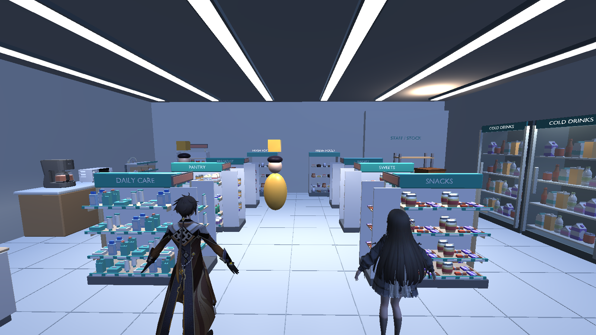
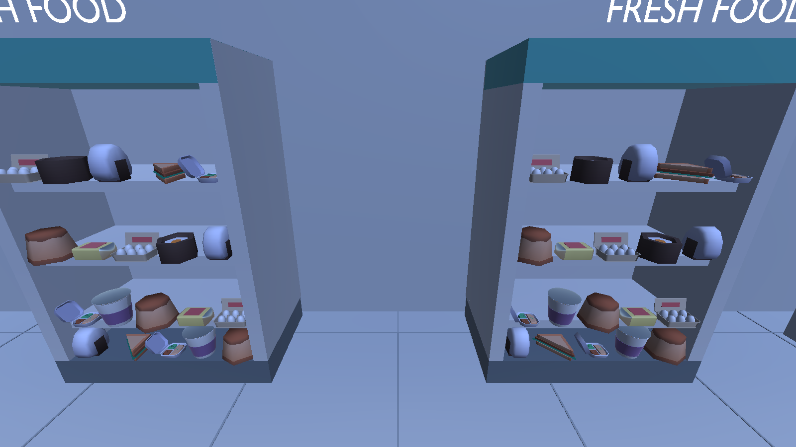
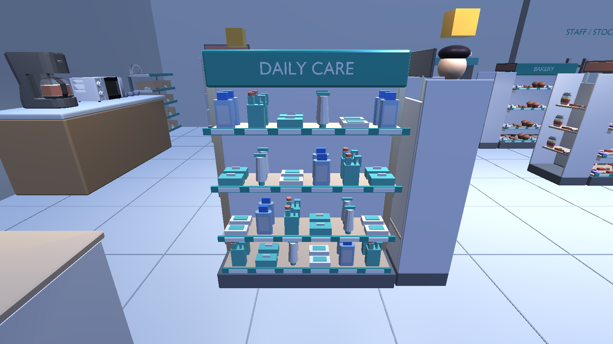
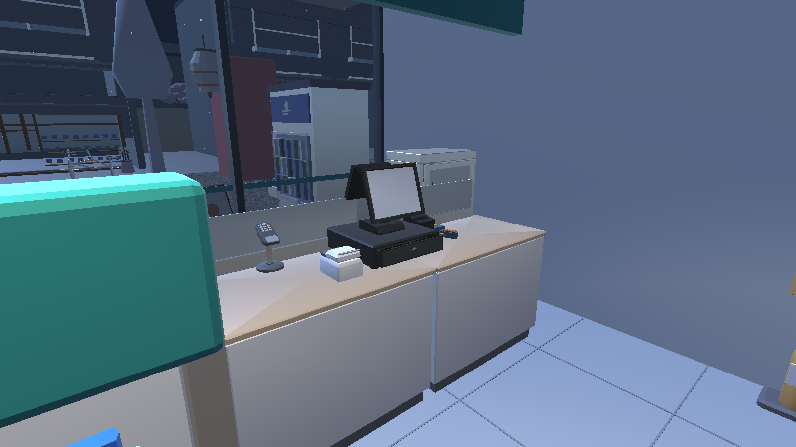
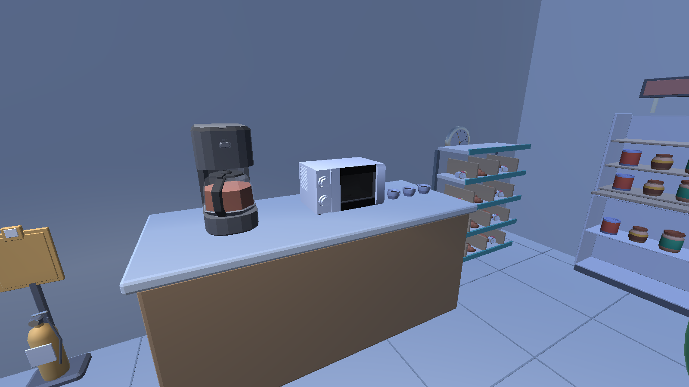

# SORA MART konbini models in Unity - 2026-11-11

## Result

The running store now uses **67 original source GLBs**, up from 19: 20 equipment
and fixture sources plus 47 food/product/accessory sources. Their **865 placements**
include **833 decorative goods/accessories**. Unselected models stay in local intake.

The layout follows [real konbini references](../SORA_MART_KONBINI_REFERENCE.md):
six low gondolas in two columns, chilled food at the rear, drinks along the right
wall, bakery/coffee along the left, checkout/hot food beside the staffed counter
and magazines/baskets/umbrellas near the window. Existing entrance, POS, restock,
delivery, inventory and shift anchors remain. This adapts the reference layout
to the playable store, rather than being a measured copy of the Kyoto shop.

## Implementation and provenance

- `Tools/Blender/build_sora_mart.py` validates source hashes/licenses, imports real
  meshes, preserves proportions/UVs, places goods at measured shelf heights and
  rebuilds the existing `Assets/Resources/SoraStore/SoraMart.glb`. Identical constant
  materials share resources; textured materials remain separate. Transparent
  materials are not merged into opaque geometry. Hot-cabinet stock blocks are
  replaced with separately downloaded food meshes.
- `SoraMartVisuals.cs` uses native static MeshColliders for imported fixtures,
  keeping collision aligned with exported geometry. Merchandise stays decorative.
  Existing roof/canopy, drink-cabinet and coffee-counter solids remain.
- Existing EditMode regression and `SoraMartReview.cs` require the new fixture
  groups, transparent storefront and open aisle. Seven genuine Play Mode camera
  captures include fresh-food, daily-care and coffee details.
- Original files, hashes, links and credits are in
  `ArtSource/ThirdParty/SoraMart/manifest.json` and `ATTRIBUTION.md`. CC0 sources:
  3D Assets, Kenney, MilkAndBanana, CreativeTrio and Quaternius. CC BY 3.0 sources:
  J-Toastie, Jarlan Perez, William Murphy and codedeck. Credits/license links ship
  through `Assets/StreamingAssets/SoraMart-THIRD-PARTY-NOTICES.txt`.
- Existing store asset GUID retained. No package, save schema, sale path or
  character source change. Local intake originals remain intact.

## Actual validation

| Check | Result and evidence |
|---|---|
| Unity import/C# compile | PASS, Unity **6000.3.7f1**, URP **17.3.0** |
| EditMode | **22/22 PASS**, feature worktree `TestResults/editmode.xml` |
| Public-city Play Mode | PASS, feature worktree `Logs/konbini-public-playmode.log`, `Artifacts/SoraMartKonbini/report.json` |
| Current checkout/private-city Play Mode | PASS, owner's checkout `Logs/konbini-current-playmode.log`, same report path |
| Store checks in each Play Mode run | **8 controller routes**, **100 switches**, draft cancellation, one sale, delivery/restock, save/load and **9 rain probes** |
| Imported city/store overlap | No checked overlap; `city-store-overlaps.txt` empty in both runs |
| Actual store geometry | **127 renderers, 91 materials, 672,066 triangles**; not an FPS or draw-call benchmark |
| Windows x64, public city | Build/startup PASS; feature worktree `Logs/windows-build.log`, `Logs/konbini-public-player.log` |
| Windows x64, current checkout | Build/startup PASS; `Logs/windows-build.log`, `Logs/konbini-current-player.log`; expanded store and private owner ZIP pair loaded |
| Source/list integrity | `python Tools/StreetExterior/verify_sora_mart_downloads.py` checks 403 downloads, 151 markers and 67 selected source hashes |

Play Mode checks restore save-file bytes. Cameras are staged review angles, not
manual keyboard walkthroughs. The public Editor logged its internal Search index
startup exception; store checks and captures completed. Standalone verification
separately rejects checked runtime exceptions or mesh readability/cooking failure.
No licensed remote CI job is dispatched manually.

Both standalone checks wait for the store and completed city startup markers;
the owner's player confirms `private AFX=True`. Build credits are present and
test-owned players are stopped afterward. Original scene/metadata bytes and
character WIP hashes are restored/preserved. The updated owner executable is
`Builds/Windows/SORA_After_the_Rain.exe`, kept with its accompanying data folder.

## Genuine Unity captures

Source-controlled images use the public city. Private city assets/captures stay
local. PNGs come directly from Unity cameras, without compositing or AI art.

## Limits

67 sources are integrated, not 403, and not all 151 requirements are complete.
[Shopping list](../../SORA_MART_MODEL_SHOPPING_LIST.md) and
[per-file CSV](../SORA_MART_DOWNLOADS.csv) distinguish download, placement and
remaining detail. Retail wrappers, Japanese labels, closed packaging and enough
variants remain incomplete for several foods/toiletries. Bare onigiri is not
certified packaged onigiri. Products stay decorative; inventory is aggregate.

Existing characters, doors and narrative are unchanged. Full animation acceptance,
manual gameplay/camera review and target-PC performance profiling remain separate.
Mesh-collider behavior and Windows startup are checked, but geometry counts alone
do not establish the final PC frame rate.
