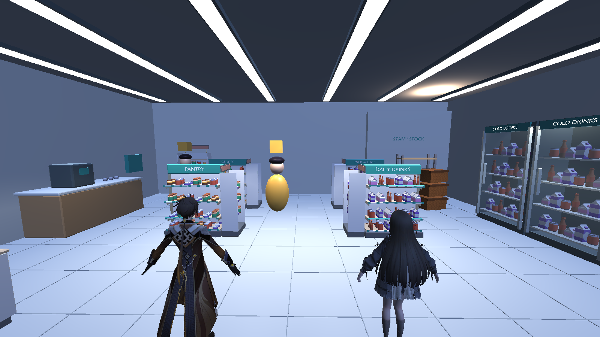
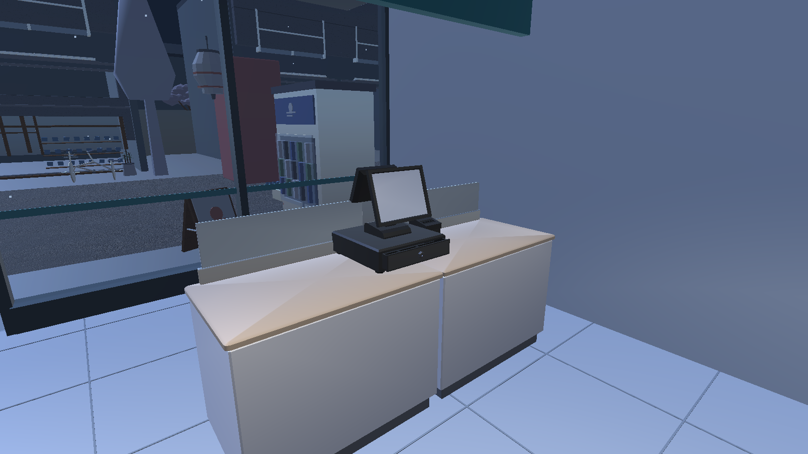

# SORA MART licensed model integration - 2026-11-11

## Objective and scope

Integrate the reviewed free-model shortlist into the existing playable store.
Do not replace the street, store envelope, characters, POS logic or save format.
The existing glass-door cabinets remain because downloaded refrigerator candidates
did not establish the required interior/glass quality.

## Architecture and changed files

- `Tools/Blender/build_sora_mart.py` validates the selected source checksums and
  licenses, imports the actual source meshes, preserves UVs/materials, uniformly
  scales fixtures/products, then exports the existing `SoraMart.glb` asset.
- Six fixture sources provide four gondolas, four endcaps, two checkout modules,
  one modern POS, a rear fixture and a stockroom shelf. Thirteen Kenney models
  provide pantry/drink displays and coffee cups. Materials are combined by source
  group, keeping imported fixtures identifiable without creating another runtime
  spawning system.
- `SoraMartVisuals.cs` disables obsolete shelf/counter colliders and adds solids
  matching the new model footprints. POS, restock, delivery, inventory and shift
  markers retain their existing identities and coordinates. Missing model fallback
  still retains the prototype.
- `DemoSceneTests.cs` and `SoraMartReview.cs` require the actual imported geometry,
  clear aisles and existing store behavior. The Play Mode report records triangle,
  material and renderer counts.
- `SoraCityRuntimeWorld.cs` uses the shared store-root name so the existing neighbor
  overlap correction still runs after the store is renamed for its mixed licenses.
- Correct the pre-existing road-sign count assertion from 128 to 64: the unchanged
  placement code creates four approaches at each of 16 intersections. No street
  placement or gameplay change accompanies this test correction.
- Source files, licenses, attribution and source hashes are in
  `ArtSource/ThirdParty/SoraMart/`. The manifest and asset register record provenance.
  `StreamingAssets/SoraMart-THIRD-PARTY-NOTICES.txt` carries credits into builds.

## Source credits and modifications

- 3D Assets: retail gondola, endcap, cash desk and rear fixture, CC0 1.0.
- POS Machine by J-Toastie, CC BY 3.0: https://poly.pizza/m/ju1CrAV1UY
- Storage Shelf by Jarlan Perez, CC BY 3.0: https://poly.pizza/m/6gKdASmfB9U
- Food Kit 2.0 by Kenney, CC0 1.0: https://kenney.nl/assets/food-kit
- Existing IzakayaAlley CC0 props and original SORA architecture remain.

Original source binaries are unchanged. The assembled model changes uniform scale,
placement and static combination. Keep creator credits and license links when
redistributing the assembled model or a game build. Project-authored artwork does
not gain a public license merely by combining it with CC0/CC BY sources.

## Validation

- **Source checks PASS:** all 19 selected GLBs have source SHA-256 records and
  complete embedded/shared texture dependencies. Blender 5.2.3 exports the actual
  mesh geometry; textures embedded in the assembled GLB are PNG, not WebP.
- **Unity 6000.3.7f1 / URP 17.3.0 compile and 22/22 EditMode PASS** in the isolated
  feature worktree based on current GitHub `main`. The store regression checks
  imported source groups, transparent glass, roof/canopy, interaction retention,
  removal of obsolete wide shelf colliders and a clear main aisle.
- **Public-city scripted Play Mode PASS:** eight controller routes across both
  twins, 100 switches, draft cancellation, one sale, delivery/restocking, save/load
  and nine repeated roof/canopy/outdoor rain probes. No duplicate checkout or city
  wall through the store. Save bytes are restored after the test.
- **Current-checkout private-city scripted Play Mode PASS:** the same checks pass
  with the owner's existing character-animation work present and `privateCity=true`.
  No character source files are included in the store PR. The owner's character WIP
  remains separate and its full EditMode suite is not claimed revalidated here.
- **Actual store geometry:** 53 renderers, 50 materials, 114,674 triangles. The
  13 Kenney sources reuse their identical palette/material in the assembled store.
  These are geometry counts, not a draw-call or FPS benchmark.
- **Windows x64 build PASS:** `Tools/Build-SORA.ps1` reports
  `Build Finished, Result: Success.` in `Logs/windows-build.log`. Standalone startup
  logs the imported store and public V03/V05/V06 city without the checked runtime
  exceptions. Attribution text is present in the built player's StreamingAssets.
  The test-owned player was stopped after startup verification.
- **Current-checkout Windows x64 build and startup also PASS:** the owner's local
  executable was rebuilt with the existing animation work and private city.
  `Logs/mart-models-current-player.log` confirms the store and owner ZIP pair load
  with `private AFX=True`, without the checked runtime exceptions. Build credits
  are present, and the original scene bytes/GUID are restored after generation.
  This verifies startup, not full character-animation acceptance or a manual shift.
- **Offline validator PASS:** `python Tools/validate_project.py`; no new packages,
  no licensed CI dispatch. Existing store/scene GUIDs and original scene bytes are
  preserved. Binaries use Git LFS.

Evidence in the feature worktree: `TestResults/editmode.xml`,
`Logs/mart-models-playmode.log`, `Logs/windows-build.log`,
`Logs/mart-models-player.log`, `Artifacts/SoraMart/public-models-report.json`.
The main checkout also has `Logs/mart-models-current-playmode.log`,
`Logs/mart-models-current-player.log`, `Logs/windows-build.log` and
`Artifacts/SoraMart/report.json` for the current private-city checks.

These are genuine Unity Play Mode camera renders at staged review angles, not
Blender previews, generated mockups or manual keyboard walkthrough captures.

## Limits

- Merchandise remains decorative and aggregate stock does not track individual SKUs.
- Thirteen stylized product/cup sources do not fulfill the 151-item procurement list.
- Japanese retail packaging/labels, additional food categories and owner art review
  remain unfinished. Existing doors remain parked open.
- Scripted traversal/camera captures do not establish manual gameplay acceptance or
  target-PC FPS/frame-time performance.

## Follow-up: konbini references and download coverage

The owner requested real-store photo references and more model categories, with
each successful download marked in the procurement list. The
[reference and model matching sheet](../SORA_MART_KONBINI_REFERENCE.md) uses a real
7-Eleven interior in Kyoto, supporting photos and Japan Guide's illustrative
floor plan. Its proposed layout is not a new Unity capture or a measured copy.

192 additional original GLBs are stored in the ignored local intake folder. The
total is **403 files with 403 different SHA-256 hashes**, across 38 source entries.
[CSV](../SORA_MART_DOWNLOADS.csv) and [JSON](../SORA_MART_DOWNLOADS.json) record each
file and its source, license, path, preview state, coverage and prior integration.
The selected 19 original source hashes still match the existing store manifest.

The updated [151-item list](../../SORA_MART_MODEL_SHOPPING_LIST.md) has **116** rows
with downloaded candidates, **5** rows with already-held CC0 source nodes and
**30** rows without candidates. Requirements for retail packaging, Japanese
labels, variant counts and close-up quality remain separate. No row is certified
fully complete. Some downloaded samples fail those criteria, including bare
onigiri, loose batteries, opened food wrappers and overly simple equipment.

Actual follow-up checks: `verify_sora_mart_downloads.py` passes for 403 distinct
GLBs, every recorded file size/hash, mesh presence, local texture dependencies,
license evidence, CC BY creator notices, exact existing source node names and all
151 status markers. The original local verifier also passes ZIP CRC and source
checks. Blender 5.2.3 previews cover 49 distinct models; these are not Unity
screenshots. Offline project validation and `git diff --check` pass.

No source asset used by the running store, C# file or Unity scene changes in this
follow-up. New candidates remain local and have **not** been imported into Unity,
tested in Play Mode or included in a Windows build. Earlier Unity results in this
report apply to the initial selected 19 sources only, not the expanded intake.
