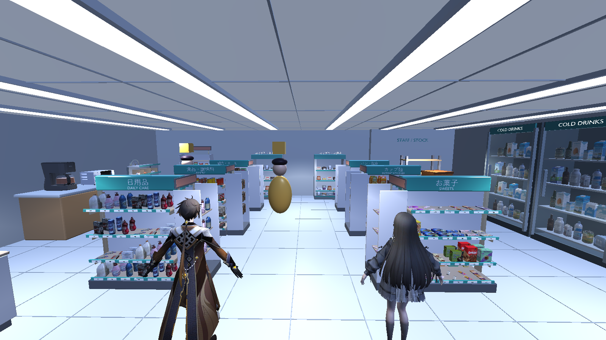
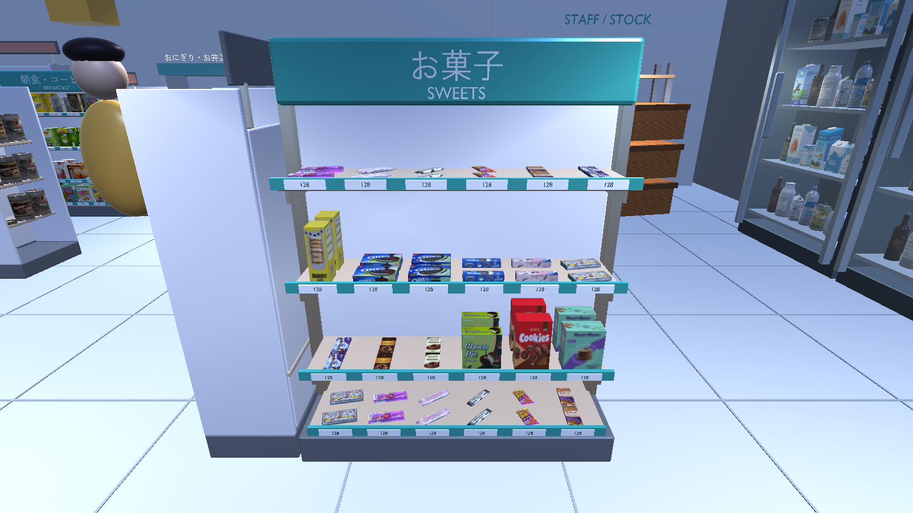
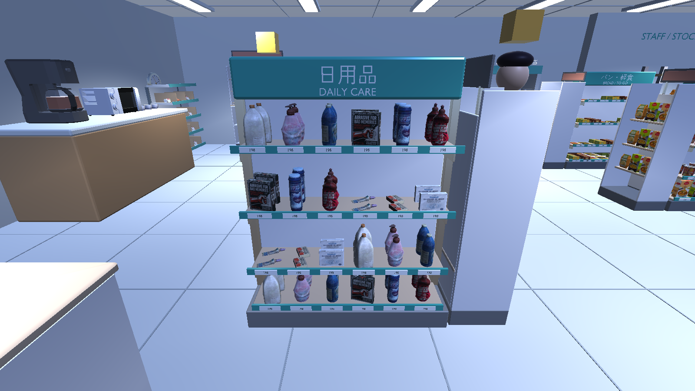
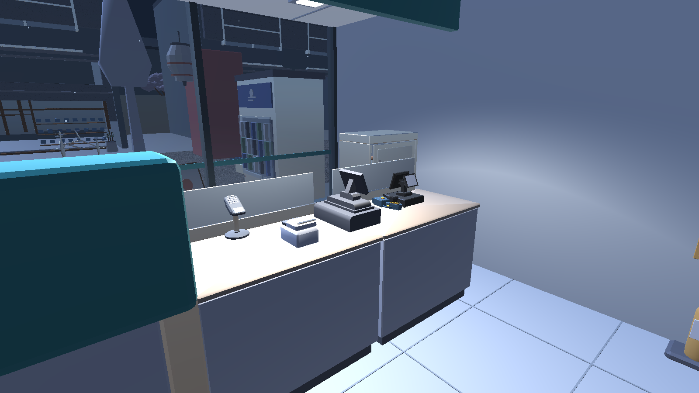
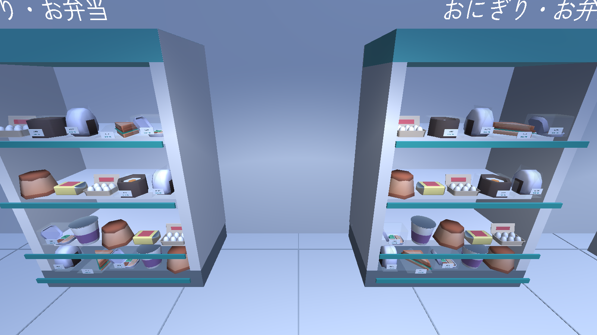

# SORA MART retail finish - 2026-11-12

The store now uses **147 active model resources**: **40 earlier source GLBs** and
**107 resources selected from the owner's separated library**. The new resources
are 40 Food Collection products, 64 PSX Food products and three Store Props
fixtures: register console, cash tray and stock carton. The source manifest retains
174 available resources; 27 earlier resources are not placed in this layout.

## Store behavior and appearance

- Replace the repeated central-shelf and chilled-drink stock with **104 textured
  product objects**: household/care goods, pantry food, breakfast, sweets, instant
  noodles, takeaway boxes and drinks. Keep proportions, source labels and UVs.
  Shared geometry/atlases are source resources, not recolored placeholder boxes.
- Keep the six gondolas, open main aisle, rear fresh-food bays, right drink wall,
  left coffee/bakery service, entrance baskets/magazines and existing gameplay
  anchors. Placement follows [R1-R6 konbini references](../SORA_MART_KONBINI_REFERENCE.md),
  adapted to the existing store footprint.
- Add Japanese/English aisle signs, printed price tickets, a lower acoustic
  ceiling and a six-light grid below the ceiling. Retain the storefront brand,
  transparent frontage and roof/canopy shelter. An interior ceiling collider also
  stops the third-person camera from entering the ceiling.
- Add clear sleeves/lids and original SORA Japanese labels around downloaded
  rice-ball, sandwich and meal models. These are authored packaging additions,
  not extra downloaded models or independent completed procurement requirements.
- Keep one gameplay register, aggregate stock, safe draft cancellation, twin
  switching and the existing save schema. Products remain decorative stock;
  this does not introduce per-SKU inventory or a second sales system.

## Source records and rights

[107-row CSV](../SORA_MART_USER_LIBRARY.csv) records each selected library ID,
source object, exact hash, pack, author, license, candidate requirement and actual
Unity use. The earlier 403-GLB intake remains in its separate CSV. The shopping
list now has **119/151 rows with downloaded candidates**, **5 rows with existing
CC0 sources** and **27 rows without candidates**. No row is certified as having
completed every packaging, variation and art requirement.

Food Collection (Melon Polygons), PSX Food (grgssblend) and Store Props
(SimplePolygon) have CC BY 4.0 metadata checked against their live Sketchfab
listings. Listing snapshots, descriptions, selected-source hashes and changes are
retained in each pack's `SOURCE.json` and `SKETCHFAB_SOURCE.json`. PSX source
triangle/vertex counts match the listing; two missing image paths were repaired
on a working copy before Blender conversion. Original downloads remain unchanged.
Source brands and labels remain visible; their copyright licenses do not grant
endorsement or independent trademark rights.

The Zen Kaku Gothic New font is retained unmodified with its SIL Open Font
License 1.1. Japanese labels are converted to mesh; no Unity font package is
added. Author credits and full CC BY 4.0/OFL notices accompany built players in
`StreamingAssets/SoraMart-THIRD-PARTY-NOTICES.txt`.

VR Store is excluded because its description identifies company-owned colleague
work, despite CC BY metadata. Toronto, Marlboro and the facade packs are also
unselected. These files stay local. The 825-resource local library keeps stable
IDs/hashes; `UNITY_SELECTION_2026-11-12.json` records the exact 107 chosen resources.

## Architecture and reproducibility

The existing single-GLB pipeline remains. `build_sora_mart.py` validates model,
image, binary-buffer and font hashes, imports chosen source groups, fits stock
to measured shelves and shares equivalent shader graphs with the same image
paths, UV, alpha and shader settings. Transparent geometry stays separate.

Original source geometry/atlases for the chosen groups reside outside `Assets`
in `ArtSource/ThirdParty/SoraMart/`; new binary formats use Git LFS. The runtime
asset stays `Assets/Resources/SoraStore/SoraMart.glb`, with GUID
`a6a69afe6ad0d5247adfc9c6bbf446be`. Existing characters and their animation edits
are outside this change.

```powershell
python Tools/StreetExterior/verify_sora_mart_downloads.py
python Tools/validate_project.py
```

The source verifier checks the legacy intake, selected resources, every source
dependency, all 151 checklist markers and both CSVs. The offline project validator
does not compile C# or run Unity.

## Actual validation

Final runtime model SHA-256:
`29a90598580e5d66b62fc7fc962bda87dcca399e674e1c28f510ac454f033193`.

| Check | Actual result and evidence |
|---|---|
| Editor/version | Unity **6000.3.7f1**, URP **17.3.0**, real glTF import/C# compile |
| EditMode | **22/22 PASS**, feature worktree `TestResults/editmode.xml` and `Logs/editmode.log` |
| Public-city Play Mode | PASS, `Logs/sora-mart-retail-public-playmode.log`, `Artifacts/SoraMartKonbini/report.json` |
| Owner checkout/private-city Play Mode | PASS, `Logs/sora-mart-finish-current-playmode-final.log`, same JSON path; `privateCity=true` |
| Gameplay in each Play Mode run | **8 routes**, **100 switches**, safe draft cancellation, one POS sale, delivery/restock, save/load and **9 rain probes** |
| Store geometry in each run | **206 renderers, 105 materials, 550,988 triangles**, **864 model placements**, including **738 new textured product placements**; these are not FPS/draw-call measurements |
| Material/camera regression | 15 shared packaging materials retain source textures; clear frontage and actual fixture collision present; main aisle clear; upward camera cast stops below interior ceiling |
| Owner Windows x64 | Build and actual standalone startup PASS; `Logs/windows-build.log`, `Logs/sora-mart-retail-player.log`, `Artifacts/SoraMartKonbini/player-report.json`; Direct3D 11, completed store/city startup, `private AFX=True`, built credits present |
| Public Windows x64 | Build and actual standalone startup PASS; same paths in the feature worktree; Direct3D 11, `privateCity=false`, built credits present |
| Source/static checks | Source/texture/buffer/font hashes, both inventory CSVs and 151 markers PASS; offline structure/GUID/JSON validator PASS; whitespace check PASS |

The owner executable is `Builds/Windows/SORA_After_the_Rain.exe`, with its
accompanying data folder. Test-owned players are stopped afterward. Play Mode
checks restore save bytes. Character and existing scene hashes are preserved;
the build script's generated scene/metadata are restored to their pre-task bytes.

The public Editor logs its existing internal `UnityEditor.Search.SearchDatabase`
startup exception. Owner Editor captures also log missing Animator-parameter
warnings from the separate character work. These do not originate in the store
scripts; character files remain unchanged. The checked owner standalone startup
logs contain no checked runtime exceptions, mesh cooking/readability errors or
missing Animator-parameter warnings. This is startup evidence, not animation QA.

## Genuine Unity captures

These are direct 1600 x 900 Play Mode camera captures using public city geometry.
Cameras are staged review angles; no compositing or AI art. Private city assets
are not published.











## Limits

The visual store pass uses the selected art and genuine runtime captures. It
does not complete all 151 procurement requirements. Some source art is Western
branded or stylized; not every package is Japanese, sealed or present in all
requested variants. Authored clear food sleeves are a first packaging pass.
Manual close-up art acceptance, keyboard/camera review, complete character
animation acceptance and target-PC performance profiling remain separate.

Doors remain parked open. Decorative product counts do not represent SKU stock
or functioning retail equipment. No new gameplay, save format, dependency or
private AFX source publication is included.
