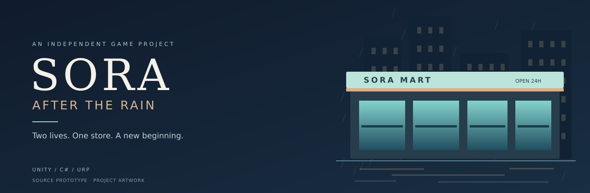
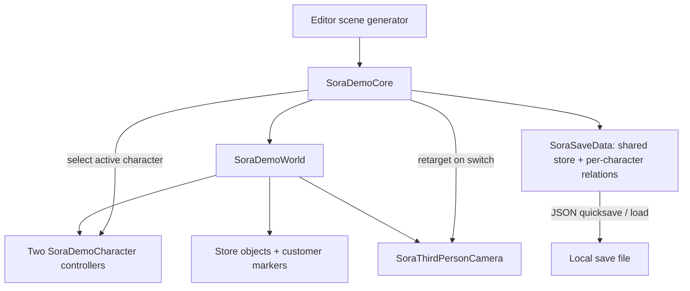

<p align="center"></p>

<h1 align="center">SORA: After the Rain</h1>

<p align="center"><strong>ふたりの生活。ひとつのコンビニ。東京で始まる新しい日々。</strong></p>

<p align="center"><a href="README.md">English</a> · <a href="README.vi.md">Tiếng Việt</a> · <a href="README.ja.md">日本語</a></p>

<p align="center"><a href="https://github.com/haizzdungnay/SORA-After-the-Rain/actions/workflows/sora-static-check.yml"></a>   </p>

## プロジェクト概要

**SORA: After the Rain** は、雨の東京を舞台にした、三人称視点のコンビニ運営・ライフシミュレーションの個人開発プロジェクトです。**Tei Toshiharu (丁俊陽)** と **Tei Akiko (明子)** は、地方から上京した18歳の双子の大学1年生。同じコンビニでのアルバイトを通じて、日々の仕事、お客さんとの関係、そして徐々に深まる人間ドラマを描きます。

設計の中心は、**お店を回しながら、自分自身の生活も築いていくこと。** プレイヤーはふたりの操作を切り替えます。店舗の所持金と在庫は共有し、お客さんとの関係はキャラクターごとに管理します。

**プロジェクトオーナー:** [Đinh Tuấn Dương / haizzdungnay](https://github.com/haizzdungnay) · AIを活用した開発 · Windows PCを先行し、モバイル対応は後の段階で検討します。

> **現在のマイルストーン: `v0.4.0-pre.1` — ソースコード段階のプロトタイプ。** ソース構成のCIは通過しています。Unityでのコンパイル、EditModeテストの実行、Play Mode、Windowsビルドは未検証です。この版にはソースとドキュメントを収録しており、動作確認済みの実行ファイルはありません。バナーはプロジェクト紹介用のグラフィックであり、ゲーム画面ではありません。

[ゲーム設計書](Docs/GAME_DESIGN_DOCUMENT_v0.4.md) · [技術構成](Docs/ARCHITECTURE.md) · [ロードマップ](Docs/ROADMAP_GITHUB.md) · [変更履歴](CHANGELOG.md) · [ポートフォリオ資料](Docs/PORTFOLIO.md)

## ゲームプレイの方向性

1. シフトを開始し、ふたりの行動に気を配る。
2. 納品の受け取り、品出し、棚卸し、レジ業務を行う。
3. お客さんとの会話や選択を通して、それぞれの人間関係を育てる。
4. シフトの実績を振り返り、その後の生活や物語につなげる。

最初の3項目には限定的なプロトタイプ実装があります。シフト全体のゲームループ、クエスト、分岐する物語は今後の開発対象です。

## 現在の実装範囲

| システム | ソース内の実装 | 検証状況 |
|---|---|---|
| ふたりの主人公 | 2体のコントローラー、Tab切り替え、非操作キャラクターの作業地点間の移動 | Editorでの検証待ち |
| カメラ・操作対象 | 三人称カメラの回転とズーム、障害物判定、近くの対象への操作表示 | Editorでの検証待ち |
| 店舗業務 | POSの仮伝票と確定、1回の納品、品出し、棚卸し、シフト集計 | テスト作成済み・未実行 |
| 人間関係 | 成人の仮NPC3名、キャラクター別の親密度と信頼度 | テスト作成済み・未実行 |
| セーブ・ロード | スキーマ1のJSON、店舗データ、ふたりの位置、関係値 | アトミックな保存と移行処理は未実装 |
| 環境 | プリミティブによる店舗、道路、照明、雨の実行時生成 | 表示確認待ち |
| 開発基盤 | アセットGUID、3つのアセンブリ、静的CI、手動のUnityテスト・ビルド | 静的チェック確認済み |

非操作キャラクターは、まだ実際の店舗業務を処理しません。客の行列、クエストグラフ、完成品質のアニメ調モデル、アニメーション、物語全体は未実装です。

## 技術的な焦点

- **状態の継続性:** 操作キャラクターを切り替えても、店舗の所持金と在庫の整合性を保つ。
- **仮伝票の境界:** 確定するまで売上を変更せず、切り替え時には仮伝票を取り消す。永続的な取引台帳は今後実装予定。
- **個別の関係値:** 人間関係を双子それぞれのデータとして管理。
- **再現可能なセットアップ:** Editorを固定し、URP設定、シーン生成、Windows用スクリプトを用意。
- **検証結果の明示:** 静的チェックと、Editor・ゲームプレイ・ビルドの実検証を区別。

## 現在の技術構成



この図は既存のプロトタイプを示します。`SoraDemoCore` は現時点で複数の責務を持ち、サービスへの分割は今後の課題です。[構成と設計上の判断](Docs/ARCHITECTURE.md)も参照してください。

## 技術スタック

| 項目 | 使用技術 |
|---|---|
| エンジン | Unity 6.3 LTS · `6000.3.7f1` |
| 言語・描画 | C# · URP `17.3.0` |
| 初期ターゲット | Windows x64 |
| 操作・仮UI | CharacterController · 旧Input Manager · IMGUI |
| 保存 | Unity JsonUtilityによるスキーマ付きJSON |
| 検証 | Pythonの静的チェック · Unity Test Framework `1.6.0` |
| 開発基盤 | GitHub Actions · ライセンス認証済みWindowsランナーは任意 · Git LFS |

## ローカルで開く

Git、Python 3、Unity Hub、**Unity Editor `6000.3.7f1`** と有効なライセンスを用意してください。必要に応じてWindowsビルド用モジュールをインストールし、バイナリアセット追加前にGit LFSを設定します。

```powershell
git clone https://github.com/haizzdungnay/SORA-After-the-Rain.git
cd SORA-After-the-Rain
python Tools/validate_project.py
```

1. Unity Hubの **Add project from disk** でクローンしたルートフォルダーを選択。
2. 指定のEditorで開き、パッケージのインポート完了を待つ。
3. **SORA → 0. Configure Prototype Project**、続いて **SORA → 1. Generate Demo Scene** を実行。
4. `Assets/SORA/Scenes/SORA_Prototype.unity` を開き、**Play** を押す。
5. 入力エラーが出る場合はActive Input Handlingを **Input Manager (Old)** または **Both** に設定。

シーンとURPアセットはEditorで生成します。検証済みシーンが同梱されているわけではありません。初回の正常なインポート後に、生成アセット、`.meta`、設定、`packages-lock.json` を確認してコミットしてください。[詳細ガイド](README_START_HERE.md)も参照してください。

## 操作

| 入力 | 動作 |
|---|---|
| WASD / Shift | 歩行 / 走行 |
| Tab | 操作する双子を切り替え |
| E | インタラクト、商品のスキャン / 会計確定 |
| 右ドラッグ / ホイール | カメラ回転 / ズーム |
| 1 / 2 / 3 | 会話の選択肢 |
| F5 / F9 / Esc | クイックセーブ / ロード / 閉じる・取り消し |

## テストとビルド

| 項目 | この版の状況 |
|---|---|
| 構成、マニフェスト、メタデータ・GUID、基本的なリポジトリ検査 | ローカルとGitHub Actionsで通過 |
| 新規クローンとソースツリーの比較 | 初回インポート時に確認済み |
| EditModeテスト5件 | 作成済み・未実行 |
| Unityインポート・コンパイル、Play Mode、描画、Windowsビルド | 未実行 |

バッチ実行前にEditorのGUIを閉じてください。

```powershell
./Tools/Test-SORA.ps1
./Tools/Build-SORA.ps1 -SmokeOnly
./Tools/Build-SORA.ps1
```

Editorが標準以外の場所にある場合は `-UnityExe` を指定します。将来のビルド成功時には `Builds/Windows/SORA_After_the_Rain.exe` と関連データを生成します。ライセンスが必要なCIは手動・明示的な有効化が必要で、信頼できる `main` のみを対象とします。現時点では実行していません。[CI設定](Docs/CI_SETUP.md)と[手動QA](Docs/TEST_CHECKLIST.md)を参照してください。

## ロードマップ

- **次の段階: Editor検証** — インポート・コンパイル問題の解消、テスト実行、実際のプレイ映像、初の検証済みWindowsビルド。
- **店舗処理の信頼性** — 伝票ID、冪等性、検証付きアトミック保存、サービス分割。
- **生きた店舗** — NPC業務、客の行列、仕事・交流クエスト、シフト全体のゲームループ。
- **ビジュアル制作** — 利用権を確認したアニメ調キャラクター、アニメーション、環境、雨・照明、PC性能測定。

## リポジトリ構成

| パス | 役割 |
|---|---|
| `Assets/SORA/Scripts/` | 実行時プロトタイプ |
| `Assets/SORA/Scripts/Editor/` | URP設定、シーン生成、ビルド |
| `Assets/SORA/Tests/Editor/` | 整合性テスト5件 |
| `Packages/`, `ProjectSettings/` | パッケージ、Editor、入力設定 |
| `Tools/`, `.github/` | スクリプト、CI、投稿用テンプレート |
| `Docs/` | 設計、技術構成、QA、ロードマップ、紹介資料 |

## 貢献・クレジット・利用条件

変更前に [CONTRIBUTING.md](CONTRIBUTING.md) と [AGENTS.md](AGENTS.md) を確認してください。コード機能はfeatureブランチとレビューを通します。不具合にはEditorのバージョン、再現手順、実際のログを添えてください。認証情報、Unityライセンス、再配布権のないアセットを公開しないでください。

v0.4のベースラインはオーナー提供のものです。AIは実装案、文書、開発フローの作成を支援しており、人によるレビューとUnity実検証が必要です。他作品のゲームアセットや参考動画は同梱しません。出典は [ASSET_REGISTER.csv](Docs/ASSET_REGISTER.csv) で管理します。

**プロジェクト全体の再配布ライセンスは未選択です。** 公開リポジトリであること自体は、オープンソースライセンスの付与を意味しません。依存パッケージには、それぞれのライセンスが適用されます。
