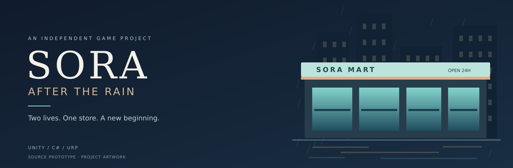
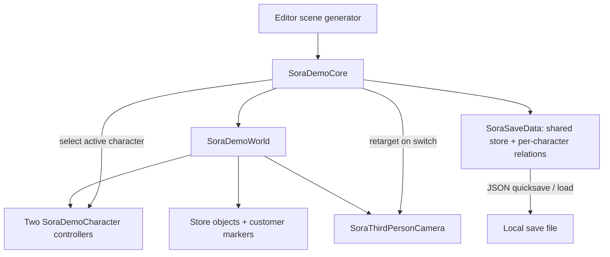

<p align="center"></p>

<h1 align="center">SORA: After the Rain</h1>

<p align="center"><strong>Two lives. One convenience store. A new beginning in Tokyo.</strong></p>

<p align="center"><a href="README.md">English</a> · <a href="README.vi.md">Tiếng Việt</a> · <a href="README.ja.md">日本語</a></p>

<p align="center"><a href="https://github.com/haizzdungnay/SORA-After-the-Rain/actions/workflows/sora-static-check.yml"></a>   </p>

## Overview

**SORA: After the Rain** is an independent third-person convenience-store and life-simulation project set in a rainy Tokyo neighborhood. **Tei Toshiharu (丁俊陽)** and **Tei Akiko (明子)** are 18-year-old twins, newly arrived from the countryside for their first year of university. A shared part-time job becomes the setting for everyday work, customer relationships and gradually unfolding drama.

The design centers on a simple tension: **keep the store running while making room for a life outside the shift.** The player can alternate between the twins while they share one store economy and develop separate customer relationships.

**Project owner:** [Đinh Tuấn Dương / haizzdungnay](https://github.com/haizzdungnay) · AI-assisted development · Windows PC first, mobile later.

> **Tagged milestone: `v0.4.0-pre.1` — source prototype.** Later local Unity import/compile, EditMode and scripted Play Mode evidence is recorded in the [current environment integration report](Docs/StreetExterior/Reports/2026-11-09-LOCAL-ENVIRONMENT-INTEGRATION.md), including Windows build status and limits. There is no published playable download. The banner is project identity artwork, not an in-game capture.

[Design document](Docs/GAME_DESIGN_DOCUMENT_v0.4.md) · [Engineering overview](Docs/ARCHITECTURE.md) · [Roadmap](Docs/ROADMAP_GITHUB.md) · [Changelog](CHANGELOG.md) · [Portfolio notes](Docs/PORTFOLIO.md)

**Environment direction (2026-11-05):** [Phased street exterior rebuild plan — Vietnamese](Docs/STREET_EXTERIOR_REBUILD_PLAN.md). The owner selected AFX/CGMotion's *Japanese street at night* as the primary visual reference. Reference inspection comes first, followed by a finished sample segment and storefront-by-storefront production. This is a planning milestone; it does not claim new art, imported assets or a completed street.

## Gameplay direction

1. Enter the shift and split attention between the two twins.
2. Receive deliveries, restock shelves, count inventory and serve at the POS.
3. Meet customers and make choices that shape each character's relationships.
4. Reconcile the shift and carry progress into the wider life-simulation story.

Steps 1–3 have limited prototype code; the complete shift loop, quests and branching story remain planned.

## What is in the source

| System | Current implementation | Acceptance |
|---|---|---|
| Dual protagonists | Two controllers; Tab swaps control without respawning; inactive twin wanders between work points | 100 scripted switches in actual local Play Mode |
| Camera and interactions | Third-person orbit/zoom, obstacle cast and nearest-object prompts | Editor verification pending |
| Store operations | Draft/confirm POS, one delivery, shelf transfers, stock count and shift summary | EditMode checks pass; scripted runtime POS; full shift walkthrough pending |
| Social state | Three adult placeholder customers; separate familiarity/trust per twin | EditMode checks pass; narrative acceptance pending |
| Save / load | Schema-1 JSON, store state, twin positions and relationship arrays | Prototype; atomic writes/migration pending |
| Environment | Imported V03/V05 city; matching optional V06; primitive interactive store and legacy fallback | Genuine local Unity captures; final visual/performance QA pending |
| Engineering workflow | Asset GUIDs, three assemblies, static CI, manual Unity test/build scripts and agent guidance | Static checks verified |

The inactive twin does not yet perform actual store tasks. Customer queues, a quest graph, production anime models, animation and a complete narrative are future work.

## Engineering focus

- **State continuity:** switch the controlled character while keeping shared cash and inventory coherent.
- **POS draft boundaries:** a draft does not charge the customer; switching cancels the pending draft. A persistent invoice ledger is planned.
- **Separate social progression:** relationships are indexed per character rather than shared between the twins.
- **Repeatable setup:** a pinned Editor, URP setup/scene-generation entry points and local Windows scripts.
- **Evidence-based delivery:** distinguish static validation from actual Editor, gameplay and build acceptance.

## Current architecture



This diagram describes the existing prototype. `SoraDemoCore` currently owns several responsibilities; modular service boundaries are a roadmap item, not a claim about the current code. See [architecture and tradeoffs](Docs/ARCHITECTURE.md).

## Technology

| Layer | Technology |
|---|---|
| Engine | Unity 6.3 LTS · `6000.3.7f1` |
| Language / rendering | C# · Universal Render Pipeline `17.3.0` |
| Initial platform | Windows x64 |
| Controls / prototype UI | CharacterController · legacy Input Manager · IMGUI |
| Persistence | Versioned JSON data with Unity JsonUtility |
| Validation | Python static checks · Unity Test Framework `1.6.0` |
| Delivery | GitHub Actions · optional licensed Windows runner · Git LFS |

## Run locally

Install Git, Python 3, Unity Hub and **Unity Editor `6000.3.7f1`**, with a valid license and Windows build support where applicable. Install Git LFS before adding art binaries.

```powershell
git clone https://github.com/haizzdungnay/SORA-After-the-Rain.git
cd SORA-After-the-Rain
python Tools/validate_project.py
```

1. In Unity Hub, choose **Add project from disk** and select the cloned root.
2. Open with the pinned Editor and wait for package import.
3. Run **SORA → 0. Configure Prototype Project**, then **SORA → 1. Generate Demo Scene**.
4. For the owner-held map ZIPs, first run `python Tools/StreetExterior/install_private_city.py`; private assets stay local. Choose **SORA → 6. Play Demo** or press **F6** to open `Assets/SORA/Scenes/SORA_Prototype.unity` and start Play Mode. Playing an empty `Untitled` scene does not start the game.
5. If input fails, select **Input Manager (Old)** or **Both** under Active Input Handling.

The scene and URP assets are generated by the Editor; they are not shipped as a previously verified scene. Commit generated assets, their `.meta` files, settings and `packages-lock.json` after the first successful Editor review. Detailed troubleshooting: [setup guide](README_START_HERE.md).

## Controls

| Input | Action |
|---|---|
| WASD / Shift | Walk / run |
| Tab | Switch the controlled twin |
| E | Interact; scan / confirm a POS sale |
| Right mouse + movement / wheel | Orbit / zoom camera |
| 1 / 2 / 3 | Dialogue choices |
| F5 / F9 / Esc | Quicksave / load / close or cancel |

## Validation and builds

| Check | Status at this milestone |
|---|---|
| Offline structure, manifest, metadata/GUID and common hygiene checks | Passed locally and in GitHub Actions |
| Fresh Git clone and source-tree comparison | Verified for the initial import |
| 20 EditMode tests | Passed locally with public assets and with the owner ZIP pair |
| Unity import/compile, scripted Play Mode and runtime camera renders | Passed locally; full manual QA pending |
| Windows x64 build and standalone startup | Passed locally; manual player walkthrough/performance pending |

Close the Editor GUI before these local batch commands:

```powershell
./Tools/Test-SORA.ps1
./Tools/Build-SORA.ps1 -SmokeOnly
./Tools/Build-SORA.ps1
```

An optional `-UnityExe` parameter selects a non-default Editor path. A successful future build produces `Builds/Windows/SORA_After_the_Rain.exe` and accompanying data. The licensed CI workflow is manual, opt-in and restricted to trusted `main`; it has not been dispatched. See [CI setup](Docs/CI_SETUP.md) and the [manual QA checklist](Docs/TEST_CHECKLIST.md).

## Roadmap

- **Next: Editor acceptance** — resolve import/compile issues, execute tests, capture real gameplay and produce the first validated Windows build.
- **Store reliability** — invoice IDs, transaction idempotency, validated atomic saves and modular services.
- **A living store** — NPC work, customer queues, store/social quests and a complete shift loop.
- **Visual production** — licensed anime characters, animation, authored environment, rain/lighting and PC profiling.

## Repository guide

| Path | Purpose |
|---|---|
| `Assets/SORA/Scripts/` | Runtime prototype and its assembly |
| `Assets/SORA/Scripts/Editor/` | URP setup, scene generation and build automation |
| `Assets/SORA/Tests/Editor/` | Store, character, scene and imported-city EditMode tests |
| `Packages/`, `ProjectSettings/` | Pinned packages, Editor and input configuration |
| `Tools/`, `.github/` | Setup, validation, CI and contribution templates |
| `Docs/` | Design baseline, architecture, QA, roadmap and portfolio notes |

## Contributions, credits and rights

Start with [CONTRIBUTING.md](CONTRIBUTING.md). Code features use feature branches and review; agents must follow [AGENTS.md](AGENTS.md). Bug reports should include the Editor version, reproduction steps and actual logs. Never upload credentials, Unity license files or assets without redistribution rights.

The owner supplied the v0.4 prototype baseline; AI assists with implementation drafts, documentation and workflow preparation. Human review and real Unity acceptance remain required. Included third-party source assets retain their own terms; the assembled private AFX city stays local and release rights remain pending. Asset provenance is tracked in [ASSET_REGISTER.csv](Docs/ASSET_REGISTER.csv).

**No project-wide redistribution license has been selected.** Public repository visibility is not an open-source license grant. Package dependencies keep their own licenses.
