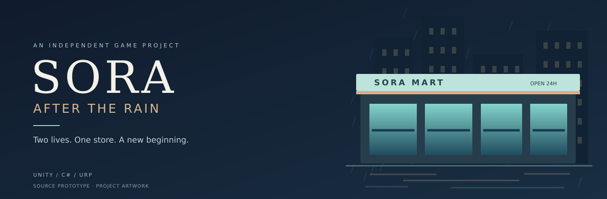
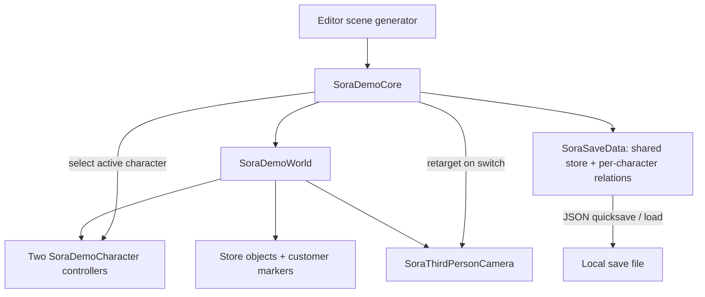

<p align="center"></p>

<h1 align="center">SORA: After the Rain</h1>

<p align="center"><strong>Hai cuộc sống. Một cửa hàng tiện lợi. Một khởi đầu mới tại Tokyo.</strong></p>

<p align="center"><a href="README.md">English</a> · <a href="README.vi.md">Tiếng Việt</a> · <a href="README.ja.md">日本語</a></p>

<p align="center"><a href="https://github.com/haizzdungnay/SORA-After-the-Rain/actions/workflows/sora-static-check.yml"></a>   </p>

## Giới thiệu

**SORA: After the Rain** là dự án game indie góc nhìn thứ ba, kết hợp quản lý cửa hàng tiện lợi và mô phỏng đời sống tại một khu phố Tokyo trong mưa. **Tei Toshiharu (丁俊陽)** và **Tei Akiko (明子)** là hai anh em sinh đôi 18 tuổi, vừa rời quê lên Tokyo học năm nhất đại học. Công việc làm thêm chung mở ra những câu chuyện đời thường, các mối quan hệ với khách hàng và drama phát triển dần.

Trọng tâm thiết kế: **vừa vận hành cửa hàng, vừa tìm chỗ cho cuộc sống riêng sau ca làm.** Người chơi đổi qua lại giữa hai nhân vật; tiền và hàng tồn dùng chung, quan hệ với khách được lưu riêng.

**Chủ dự án:** [Đinh Tuấn Dương / haizzdungnay](https://github.com/haizzdungnay) · Phát triển có AI hỗ trợ · Windows PC trước, mobile sau.

> **Mốc hiện tại: `v0.4.0-pre.1` — source prototype.** CI kiểm tra cấu trúc source đã đạt. Chưa nghiệm thu biên dịch Unity, chạy EditMode tests, Play Mode hay build Windows. Mốc này cung cấp source và tài liệu; chưa có bản chơi được xác minh. Banner là hình nhận diện dự án, không phải ảnh chụp gameplay.

[GDD](Docs/GAME_DESIGN_DOCUMENT_v0.4.md) · [Kiến trúc](Docs/ARCHITECTURE.md) · [Lộ trình](Docs/ROADMAP_GITHUB.md) · [Changelog](CHANGELOG.md) · [Nội dung portfolio](Docs/PORTFOLIO.md)

## Định hướng gameplay

1. Bắt đầu ca và phân chia sự chú ý giữa hai anh em.
2. Nhận hàng, xếp kệ, kiểm kê và phục vụ tại quầy POS.
3. Gặp khách, lựa chọn cách ứng xử và phát triển quan hệ riêng cho từng nhân vật.
4. Đối soát cuối ca, mang tiến trình vào câu chuyện đời sống rộng hơn.

Ba bước đầu mới có mã prototype ở phạm vi hẹp. Vòng lặp ca làm đầy đủ, quest và truyện phân nhánh còn nằm trong lộ trình.

## Những gì source hiện có

| Hệ thống | Mức triển khai hiện tại | Nghiệm thu |
|---|---|---|
| Hai nhân vật | Hai controller; Tab đổi điều khiển, không tạo lại nhân vật; người không điều khiển di chuyển giữa các điểm làm việc | Chờ kiểm tra trong Editor |
| Camera và tương tác | Camera góc nhìn thứ ba, xoay/zoom, cast tránh vật cản, gợi ý đối tượng gần nhất | Chờ kiểm tra trong Editor |
| Nghiệp vụ cửa hàng | POS nháp/xác nhận, một đợt giao hàng, chuyển hàng từ kho lên kệ, kiểm kê, bảng cuối ca | Đã viết tests; chưa chạy |
| Quan hệ | Ba khách trưởng thành dạng placeholder; familiarity/trust riêng cho mỗi nhân vật | Đã viết tests; chưa chạy |
| Save/load | JSON schema 1, tiền/hàng, vị trí hai nhân vật, mảng quan hệ | Chưa có ghi nguyên tử và migration |
| Bối cảnh | Sinh cửa hàng, phố, đèn và mưa bằng hình khối lúc runtime | Chưa nghiệm thu hình ảnh |
| Quy trình kỹ thuật | GUID asset, ba assembly, CI tĩnh, script test/build thủ công, hướng dẫn AI | Kiểm tra tĩnh đã đạt |

Nhân vật còn lại chưa thực sự thực hiện nghiệp vụ. Hàng đợi khách, quest graph, model anime hoàn chỉnh, animation và cốt truyện đầy đủ chưa được triển khai.

## Điểm nhấn kỹ thuật

- **Tính liên tục của trạng thái:** đổi người điều khiển mà vẫn giữ tiền và hàng tồn nhất quán.
- **Ranh giới hóa đơn nháp:** chưa xác nhận thì chưa thu tiền; đổi nhân vật sẽ hủy nháp. Ledger hóa đơn bền vững là bước kế tiếp.
- **Quan hệ tách biệt:** dữ liệu quen biết và tin cậy được lưu theo từng nhân vật.
- **Môi trường tái lập:** cố định Editor, có bước cấu hình URP, sinh scene và script Windows.
- **Bằng chứng rõ ràng:** phân biệt kiểm tra source với compile, gameplay và build thực tế.

## Kiến trúc hiện tại



Sơ đồ mô tả mã prototype đang có. `SoraDemoCore` hiện kiêm nhiều trách nhiệm; việc tách thành các service còn nằm trong lộ trình. Xem [kiến trúc và đánh đổi](Docs/ARCHITECTURE.md).

## Công nghệ

| Thành phần | Công nghệ |
|---|---|
| Engine | Unity 6.3 LTS · `6000.3.7f1` |
| Ngôn ngữ / đồ họa | C# · URP `17.3.0` |
| Nền tảng đầu tiên | Windows x64 |
| Điều khiển / UI prototype | CharacterController · Input Manager cũ · IMGUI |
| Lưu trữ | JSON có schema, dùng Unity JsonUtility |
| Kiểm tra | Python static checks · Unity Test Framework `1.6.0` |
| Quy trình phát triển | GitHub Actions · runner Windows có license tùy chọn · Git LFS |

## Khởi chạy trên máy cá nhân

Cài Git, Python 3, Unity Hub và **Unity Editor `6000.3.7f1`** với license hợp lệ; cài thành phần build Windows phù hợp nếu cần. Cài Git LFS trước khi thêm asset nhị phân.

```powershell
git clone https://github.com/haizzdungnay/SORA-After-the-Rain.git
cd SORA-After-the-Rain
python Tools/validate_project.py
```

1. Trong Unity Hub, chọn **Add project from disk**, trỏ tới thư mục vừa clone.
2. Mở bằng Editor đã cố định, chờ import package.
3. Chạy **SORA → 0. Configure Prototype Project**, rồi **SORA → 1. Generate Demo Scene**.
4. Mở `Assets/SORA/Scenes/SORA_Prototype.unity` và nhấn **Play**.
5. Nếu lỗi input, đặt Active Input Handling thành **Input Manager (Old)** hoặc **Both**.

Scene và asset URP sẽ do Editor sinh ra, chưa phải scene đã nghiệm thu. Sau lần mở thành công, review rồi commit các asset, `.meta`, settings và `packages-lock.json`. Hướng dẫn chi tiết: [README_START_HERE.md](README_START_HERE.md).

## Phím điều khiển

| Phím | Tác dụng |
|---|---|
| WASD / Shift | Đi bộ / chạy |
| Tab | Đổi nhân vật |
| E | Tương tác; quét hàng / xác nhận POS |
| Giữ chuột phải + di chuột / con lăn | Xoay / zoom camera |
| 1 / 2 / 3 | Chọn hội thoại |
| F5 / F9 / Esc | Lưu nhanh / tải / đóng hoặc hủy |

## Kiểm thử và build

| Hạng mục | Trạng thái ở mốc này |
|---|---|
| Cấu trúc, manifest, metadata/GUID và vệ sinh repo cơ bản | PASS ở local và GitHub Actions |
| Clone mới và đối chiếu cây source | Đã xác minh ở lần import đầu |
| Năm EditMode tests | Đã viết; chưa chạy |
| Import/compile Unity, Play Mode, hình ảnh và build Windows | Chưa chạy |

Đóng cửa sổ Editor trước khi chạy batch:

```powershell
./Tools/Test-SORA.ps1
./Tools/Build-SORA.ps1 -SmokeOnly
./Tools/Build-SORA.ps1
```

Thêm `-UnityExe` nếu Editor nằm ở đường dẫn khác. Khi build thành công thực tế, kết quả nằm ở `Builds/Windows/SORA_After_the_Rain.exe` cùng thư mục dữ liệu. CI có license chỉ chạy thủ công, cần bật chủ động và chỉ dùng source `main` đáng tin cậy; hiện chưa kích hoạt. Xem [CI_SETUP.md](Docs/CI_SETUP.md) và [checklist QA](Docs/TEST_CHECKLIST.md).

## Lộ trình

- **Ưu tiên kế tiếp: nghiệm thu Editor** — sửa lỗi import/compile, chạy tests, quay gameplay thật, tạo bản Windows đầu tiên được xác minh.
- **Độ tin cậy nghiệp vụ** — ID hóa đơn, idempotency, save nguyên tử có kiểm tra, tách service.
- **Cửa hàng có sức sống** — NPC làm việc, khách xếp hàng, quest công việc/xã hội và ca làm đầy đủ.
- **Đồ họa sản xuất** — nhân vật anime có quyền sử dụng, animation, môi trường dựng sẵn, mưa/ánh sáng và đo hiệu năng PC.

## Tài liệu và cấu trúc

| Đường dẫn | Vai trò |
|---|---|
| `Assets/SORA/Scripts/` | Mã runtime prototype |
| `Assets/SORA/Scripts/Editor/` | Cấu hình URP, sinh scene, build |
| `Assets/SORA/Tests/Editor/` | Năm bài kiểm thử tính nhất quán |
| `Packages/`, `ProjectSettings/` | Cấu hình package, phiên bản Editor và input |
| `Tools/`, `.github/` | Script, CI và mẫu đóng góp |
| `Docs/` | Thiết kế, kiến trúc, QA, roadmap và portfolio |

## Đóng góp, ghi nhận và quyền sử dụng

Đọc [CONTRIBUTING.md](CONTRIBUTING.md) và [AGENTS.md](AGENTS.md) trước khi thay đổi. Tính năng code đi qua feature branch và review. Báo lỗi cần có phiên bản Editor, bước tái hiện và log thật; không đưa khóa bí mật, license Unity hoặc asset thiếu quyền phân phối vào repo.

Baseline v0.4 do chủ dự án cung cấp; AI hỗ trợ bản nháp triển khai, tài liệu và quy trình. Review của con người và nghiệm thu Unity vẫn cần thực hiện. Repo không phân phối asset của game khác hay video tham chiếu. Nguồn asset được ghi tại [ASSET_REGISTER.csv](Docs/ASSET_REGISTER.csv).

**Chưa chọn giấy phép phân phối chung cho dự án.** Repo công khai không đồng nghĩa cấp giấy phép mã nguồn mở. Các dependency giữ giấy phép riêng.
